# Lab 01: Contract-First API Design with OpenAPI 3

You will build a contract-first REST service using OpenAPI 3.0.3 and Node.js with Express. The service implements an idempotent order creation endpoint (`POST /api/v1/orders`), a cursor-based pagination query endpoint (`GET /api/v1/orders`), and standardized RFC 7807 Problem Details error responses. All incoming requests are validated against the contract before execution, and the service is exposed externally through the Poridhi Load Balancer on port 5000.

<p align="center">
  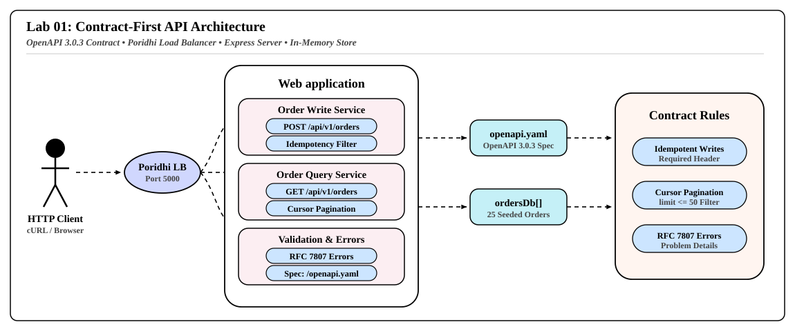
</p>

---

## Concepts

| Term | Definition |
| :--- | :--- |
| **Contract-First Design** | An API architecture approach where the interface specification is defined and reviewed before implementation code is written. |
| **OpenAPI 3.0.3** | A standardized specification format used to describe endpoints, headers, payload schemas, and response codes. |
| **Cursor Pagination** | A pagination method that retrieves records sequentially after a unique pointer (`WHERE id > cursor LIMIT limit`), preventing duplicate items during concurrent writes. |
| **Idempotency Key** | A unique client-provided token supplied via the `Idempotency-Key` HTTP header that prevents duplicate resource creation during retries. |
| **RFC 7807 Problem Details** | An IETF standard (`application/problem+json`) defining machine-readable HTTP error payloads containing `type`, `title`, `status`, `detail`, and `instance`. |
| **URI Versioning** | Explicit versioning within the URL path (`/api/v1/...`) that preserves backward compatibility for existing consumers. |

In a contract-first workflow, the API specification is authored before any server code is implemented. The OpenAPI document defines required headers, request payloads, response schemas, and status codes. When requests arrive, the server validates client parameters against these contract definitions. If a request violates the schema or omits required headers, the server rejects the call with an RFC 7807 Problem Details error payload. Valid mutations persist to the data store, and subsequent queries stream records chronologically using cursor pointers.

---

## Objectives

- Configure the project workspace with Express and YAML parser dependencies.
- Author an OpenAPI 3.0.3 specification defining `/orders` endpoints, write idempotency headers, query limits, and RFC 7807 error models.
- Implement an Express server stub that enforces the OpenAPI contract rules and manages in-memory order data.
- Expose the application using the Poridhi Load Balancer on port 5000.
- Verify contract enforcement, boundary restrictions, cursor pagination, and automated unit tests.

---

## What You Will Build

```text
lab01-contract-first-api/
├── openapi.yaml       # OpenAPI 3.0.3 contract specification
├── package.json       # Node.js dependencies and script definitions
├── server.js          # Express server enforcing contract rules
└── test.js            # Automated contract validation test suite
```

The OpenAPI contract defines the request and response interface, the Express server executes the business logic while enforcing contract boundaries, and the automated test script verifies compliance across all endpoints.

---

## Step 1: Initialize the Project Workspace

Create the project directory:

```bash
mkdir -p ~/lab01-contract-first-api
cd ~/lab01-contract-first-api
```

<p align="center">
  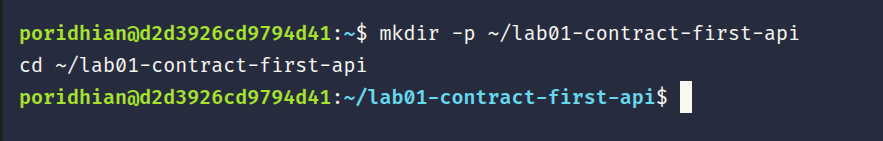
</p>

Create a file named `package.json` with the following contents:

```json
{
  "name": "lab01-contract-first-api",
  "version": "1.0.0",
  "description": "Lab 01: Contract-First API with OpenAPI 3",
  "main": "server.js",
  "scripts": {
    "start": "node server.js",
    "test": "node test.js"
  },
  "dependencies": {
    "express": "^4.19.2",
    "yaml": "^2.4.2"
  }
}
```

<p align="center">
  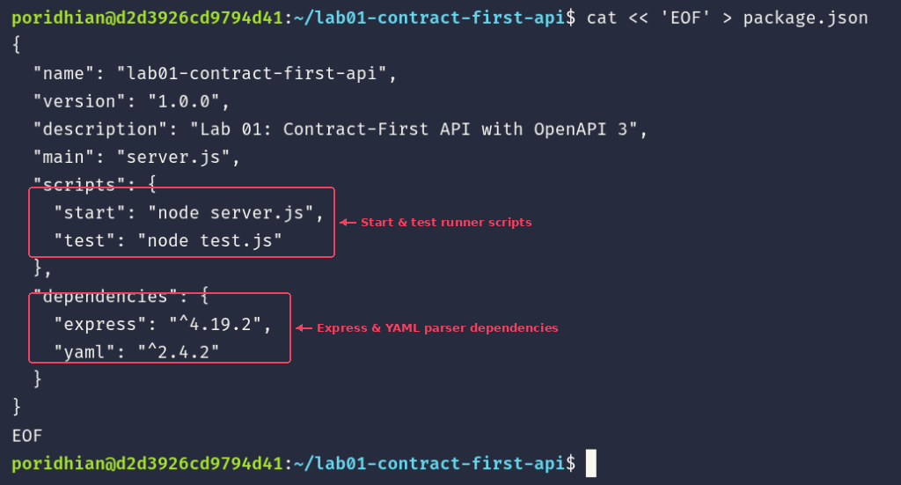
</p>

**Explanation:**
- `main`: Points to `server.js` as the entrypoint file of the application.
- `scripts.start`: Defines the command `node server.js` to run the Express server.
- `scripts.test`: Defines the command `node test.js` to execute the automated verification test suite.
- `dependencies.express`: Installs the Express web framework for routing and HTTP handling.
- `dependencies.yaml`: Installs the YAML parser library to load and inspect `openapi.yaml` at runtime.

Install the project dependencies:

```bash
npm install
```

<p align="center">
  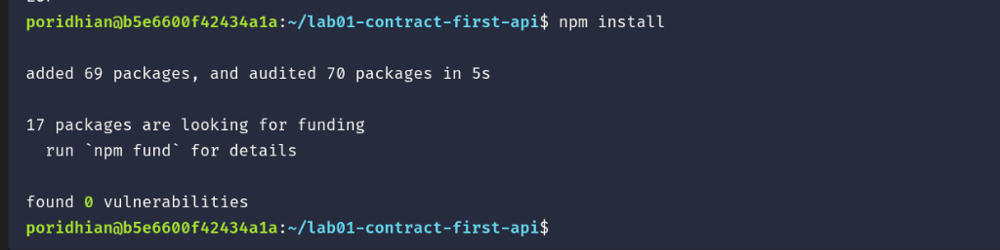
</p>

Expected output:

```text
added 69 packages in 2s
found 0 vulnerabilities
```

---

## Step 2: Define the OpenAPI 3.0.3 Contract

Create a file named `openapi.yaml` with the following contents:

```yaml
openapi: 3.0.3
info:
  title: Orders Service API
  version: 1.0.0
  description: Contract-first API specification supporting cursor pagination, idempotency keys, and RFC 7807 error formats.
servers:
  - url: http://localhost:5000/api/v1
    description: Local Development Server

paths:
  /orders:
    post:
      summary: Create an order (Idempotent write)
      description: Submits a new order mutation. The client MUST include an Idempotency-Key header to prevent duplicate orders upon retries.
      operationId: createOrder
      parameters:
        - name: Idempotency-Key
          in: header
          required: true
          description: Unique client-generated token (UUID v4) guaranteeing idempotent execution.
          schema:
            type: string
            format: uuid
            example: "9b1deb4d-3b7d-4bad-9bdd-2b0d7b3dcb6d"
      requestBody:
        required: true
        content:
          application/json:
            schema:
              $ref: '#/components/schemas/CreateOrderRequest'
      responses:
        '201':
          description: Order successfully placed and committed.
          headers:
            Location:
              schema:
                type: string
                example: "/api/v1/orders/101"
          content:
            application/json:
              schema:
                $ref: '#/components/schemas/OrderResponse'
        '400':
          $ref: '#/components/responses/ProblemDetails400'

    get:
      summary: List orders with cursor-based pagination
      description: Retrieves a chronological stream of orders using high-performance cursor pagination.
      operationId: listOrders
      parameters:
        - name: cursor
          in: query
          required: false
          description: Opaque cursor identifier representing the last seen order ID.
          schema:
            type: integer
            example: 100
        - name: limit
          in: query
          required: false
          description: Number of records to return per page.
          schema:
            type: integer
            minimum: 1
            maximum: 50
            default: 10
            example: 10
      responses:
        '200':
          description: Paginated collection of orders.
          content:
            application/json:
              schema:
                $ref: '#/components/schemas/PaginatedOrdersResponse'
        '400':
          $ref: '#/components/responses/ProblemDetails400'

components:
  schemas:
    CreateOrderRequest:
      type: object
      required:
        - item_id
        - quantity
        - amount
      properties:
        item_id:
          type: integer
          example: 402
        quantity:
          type: integer
          minimum: 1
          example: 2
        amount:
          type: number
          format: float
          minimum: 0.01
          example: 150.50

    OrderResponse:
      type: object
      required:
        - id
        - item_id
        - quantity
        - amount
        - status
        - created_at
      properties:
        id:
          type: integer
          example: 101
        item_id:
          type: integer
          example: 402
        quantity:
          type: integer
          example: 2
        amount:
          type: number
          example: 150.50
        status:
          type: string
          enum: [PENDING, CONFIRMED, COMPLETED]
          example: CONFIRMED
        created_at:
          type: string
          format: date-time
          example: "2026-10-02T10:00:00Z"

    PaginationMetadata:
      type: object
      required:
        - next_cursor
        - has_more
        - count
      properties:
        next_cursor:
          type: integer
          nullable: true
          example: 110
        has_more:
          type: boolean
          example: true
        count:
          type: integer
          example: 10

    PaginatedOrdersResponse:
      type: object
      required:
        - data
        - pagination
      properties:
        data:
          type: array
          items:
            $ref: '#/components/schemas/OrderResponse'
        pagination:
          $ref: '#/components/schemas/PaginationMetadata'

    ProblemDetails:
      type: object
      description: RFC 7807 standard error structure.
      required:
        - type
        - title
        - status
        - detail
      properties:
        type:
          type: string
          format: uri
          example: "https://api.example.com/errors/invalid-parameter"
        title:
          type: string
          example: "Invalid Request Parameter"
        status:
          type: integer
          example: 400
        detail:
          type: string
          example: "The limit parameter exceeds maximum allowed of 50."
        instance:
          type: string
          example: "/api/v1/orders"

  responses:
    ProblemDetails400:
      description: Bad Request (RFC 7807 Problem Details).
      content:
        application/problem+json:
          schema:
            $ref: '#/components/schemas/ProblemDetails'
```

<p align="center">
  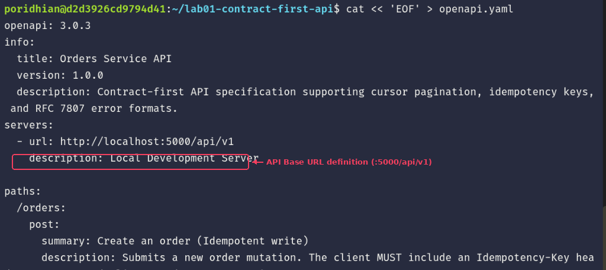
</p>

**Explanation:**
- `servers.url`: Specifies `http://localhost:5000/api/v1` as the base URI path to enforce explicit API versioning.
- `paths./orders.post.parameters`: Declares the `Idempotency-Key` header with `required: true` and UUID formatting.
- `paths./orders.get.parameters`: Defines `cursor` and `limit` query parameters with explicit validation boundaries (`minimum: 1, maximum: 50, default: 10`).
- `components.schemas.CreateOrderRequest`: Enforces mandatory fields (`item_id`, `quantity`, `amount`) and minimum values (`quantity >= 1`, `amount >= 0.01`).
- `components.schemas.ProblemDetails`: Declares the RFC 7807 error format with `type`, `title`, `status`, `detail`, and `instance` properties.
- `components.responses.ProblemDetails400`: Maps bad requests to `application/problem+json` to standardize error communication across consumers.

---

## Step 3: Implement the Contract-Compliant Server Stub

Create a file named `server.js` with the following contents:

```javascript
const express = require('express');
const fs = require('fs');
const path = require('path');
const yaml = require('yaml');

const app = express();
const PORT = process.env.PORT || 5000;

app.use(express.json());

// Load and parse OpenAPI 3 contract
const openapiPath = path.join(__dirname, 'openapi.yaml');
const openapiSpec = yaml.parse(fs.readFileSync(openapiPath, 'utf8'));

// Helper: RFC 7807 Problem Details Formatter
function sendProblem(res, status, title, detail, instance, type = "about:blank") {
  res.setHeader('Content-Type', 'application/problem+json');
  return res.status(status).json({
    type,
    title,
    status,
    detail,
    instance
  });
}

// In-Memory Orders Database (Seeded with 25 records for pagination testing)
let ordersDb = [];
let nextOrderId = 101;

for (let i = 1; i <= 25; i++) {
  ordersDb.push({
    id: nextOrderId++,
    item_id: 400 + (i % 5),
    quantity: (i % 3) + 1,
    amount: parseFloat((25.5 * i).toFixed(2)),
    status: 'CONFIRMED',
    created_at: new Date(Date.now() - (25 - i) * 60000).toISOString()
  });
}

// Route: Expose raw OpenAPI Spec
app.get('/openapi.yaml', (req, res) => {
  res.setHeader('Content-Type', 'text/yaml');
  res.sendFile(openapiPath);
});

// Route: POST /api/v1/orders (Contract-First Mutation Endpoint)
app.post('/api/v1/orders', (req, res) => {
  const idempotencyKey = req.header('Idempotency-Key');

  // Contract Check: Header requirement
  if (!idempotencyKey) {
    return sendProblem(
      res,
      400,
      'Missing Required Header',
      'The Idempotency-Key header is required for this write operation.',
      '/api/v1/orders',
      'https://api.example.com/errors/missing-header'
    );
  }

  // Contract Check: Request Body fields & types
  const { item_id, quantity, amount } = req.body || {};
  if (typeof item_id !== 'number' || typeof quantity !== 'number' || typeof amount !== 'number') {
    return sendProblem(
      res,
      400,
      'Invalid Request Body',
      'item_id, quantity, and amount must all be numbers.',
      '/api/v1/orders',
      'https://api.example.com/errors/invalid-body'
    );
  }

  if (quantity < 1 || amount <= 0) {
    return sendProblem(
      res,
      400,
      'Value Out of Bounds',
      'quantity must be >= 1 and amount must be > 0.',
      '/api/v1/orders',
      'https://api.example.com/errors/out-of-bounds'
    );
  }

  // Create Order Entity
  const newOrder = {
    id: nextOrderId++,
    item_id,
    quantity,
    amount: parseFloat(amount.toFixed(2)),
    status: 'CONFIRMED',
    created_at: new Date().toISOString()
  };

  ordersDb.push(newOrder);

  res.setHeader('Location', `/api/v1/orders/${newOrder.id}`);
  return res.status(201).json(newOrder);
});

// Route: GET /api/v1/orders (Cursor-Based Pagination Endpoint)
app.get('/api/v1/orders', (req, res) => {
  let limit = parseInt(req.query.limit, 10);
  if (isNaN(limit)) {
    limit = 10; // Default per OpenAPI contract
  }

  // Contract Check: Limit bounds [1..50]
  if (limit < 1 || limit > 50) {
    return sendProblem(
      res,
      400,
      'Invalid Query Parameter',
      `The limit parameter must be between 1 and 50. Received: ${req.query.limit}`,
      '/api/v1/orders',
      'https://api.example.com/errors/invalid-parameter'
    );
  }

  const cursor = req.query.cursor ? parseInt(req.query.cursor, 10) : 0;

  // Filter records chronologically after cursor ID
  const filtered = ordersDb.filter(o => o.id > cursor);
  const pageItems = filtered.slice(0, limit);

  const nextCursor = pageItems.length > 0 ? pageItems[pageItems.length - 1].id : null;
  const hasMore = filtered.length > limit;

  return res.status(200).json({
    data: pageItems,
    pagination: {
      next_cursor: hasMore ? nextCursor : null,
      has_more: hasMore,
      count: pageItems.length
    }
  });
});

if (require.main === module) {
  app.listen(PORT, () => {
    console.log(`[Lab 01] Contract-First Server running on port ${PORT}`);
    console.log(`OpenAPI Spec accessible at http://localhost:${PORT}/openapi.yaml`);
  });
}

module.exports = app;
```

<p align="center">
  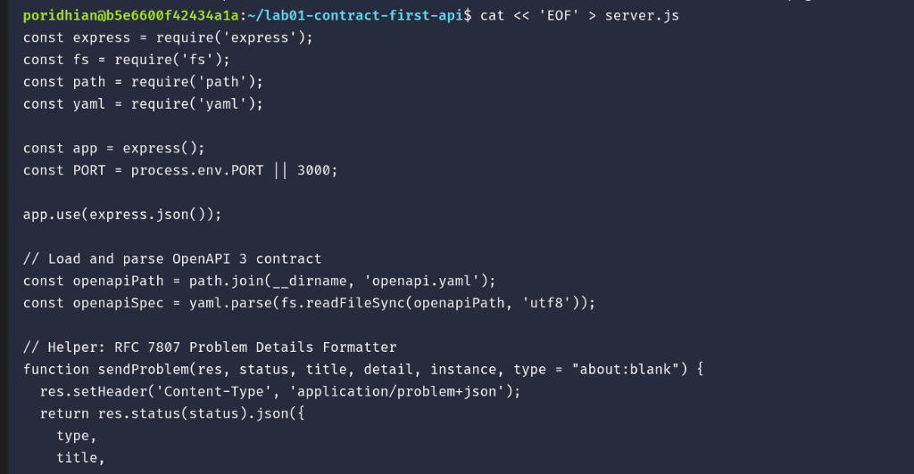
</p>

**Explanation:**
- `yaml.parse(fs.readFileSync(...))`: Reads and parses `openapi.yaml` into memory upon server startup.
- `sendProblem()`: Helper function setting `Content-Type: application/problem+json` and returning RFC 7807 compliant error payloads.
- `ordersDb`: In-memory array pre-seeded with 25 records to enable immediate cursor pagination verification.
- `req.header('Idempotency-Key')`: Checks for the presence of the required idempotency key header, returning an RFC 7807 400 error if missing.
- `res.setHeader('Location', ...)`: Returns the resource URI for newly created orders alongside `HTTP 201 Created`.
- `ordersDb.filter(o => o.id > cursor)`: Executes cursor-based pagination by selecting items strictly greater than the cursor ID and slicing up to the validated `limit`.

---

## Step 4: Expose the Server via Poridhi Load Balancer

Start the server process in the background on port 5000:

```bash
node server.js &
```

<p align="center">
  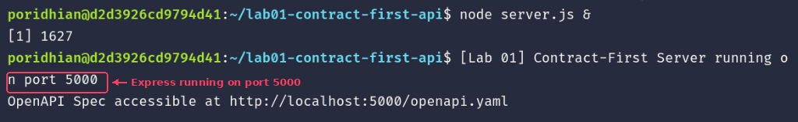
</p>

Retrieve the private IP address of your virtual machine:

```bash
hostname -I | awk '{print $1}'
```

<p align="center">
  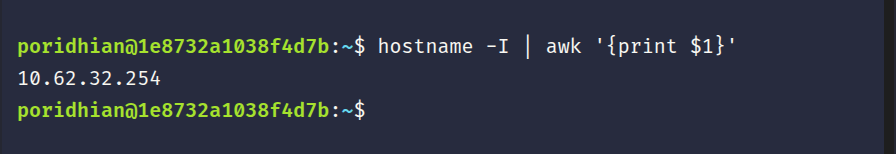
</p>

Configure the Poridhi Load Balancer:
1. Open the **Load Balancer** modal in the Poridhi interface.
2. Enter the IP address obtained from `hostname -I`.
3. Set the target port to `5000`.

<p align="center">
  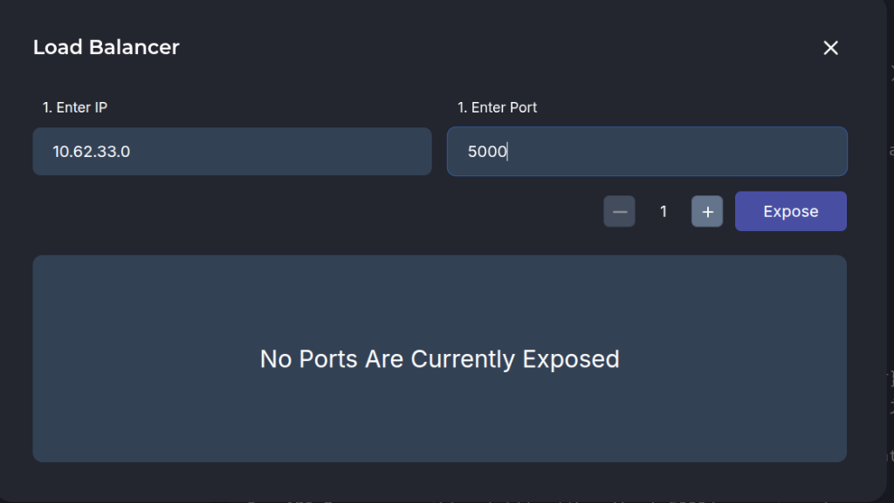
</p>

Click **Expose** to generate an active public URL:

<p align="center">
  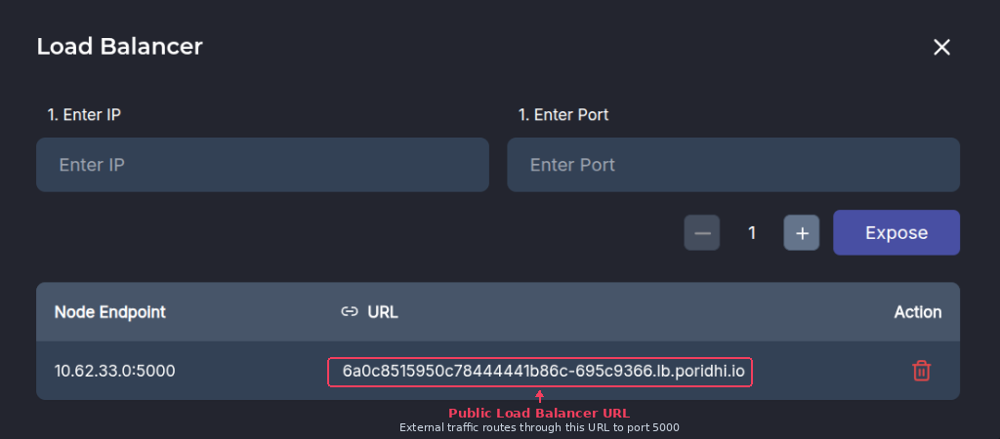
</p>

Open the generated Load Balancer URL in your web browser to confirm connectivity:

<p align="center">
  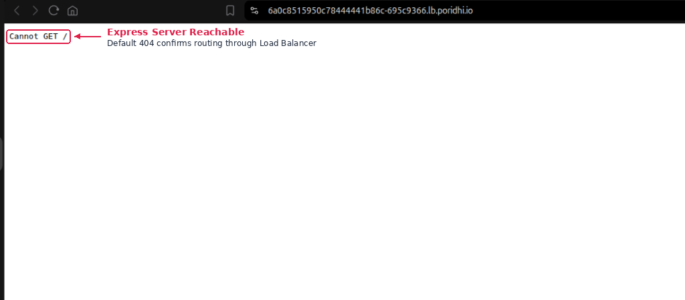
</p>

---

## Verification

You will verify contract validation, mutation handling, query parameter limits, and cursor pagination using `curl` and the automated test runner.

### Scenario 1: Missing Idempotency-Key Header (Expected 400 Bad Request)

Execute a `POST` request without the `Idempotency-Key` header:

```bash
curl -i -X POST http://localhost:5000/api/v1/orders \
  -H "Content-Type: application/json" \
  -d '{"item_id": 402, "quantity": 1, "amount": 99.50}'
```

<p align="center">
  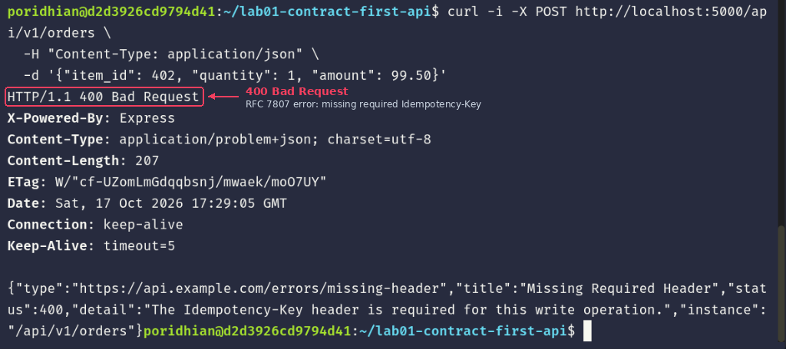
</p>

Expected output:

```text
HTTP/1.1 400 Bad Request
Content-Type: application/problem+json; charset=utf-8

{
  "type": "https://api.example.com/errors/missing-header",
  "title": "Missing Required Header",
  "status": 400,
  "detail": "The Idempotency-Key header is required for this write operation.",
  "instance": "/api/v1/orders"
}
```

### Scenario 2: Valid Order Placement (Expected 201 Created)

Execute a `POST` request supplying a valid `Idempotency-Key` header:

```bash
curl -i -X POST http://localhost:5000/api/v1/orders \
  -H "Content-Type: application/json" \
  -H "Idempotency-Key: 9b1deb4d-3b7d-4bad-9bdd-2b0d7b3dcb6d" \
  -d '{"item_id": 402, "quantity": 2, "amount": 199.00}'
```

<p align="center">
  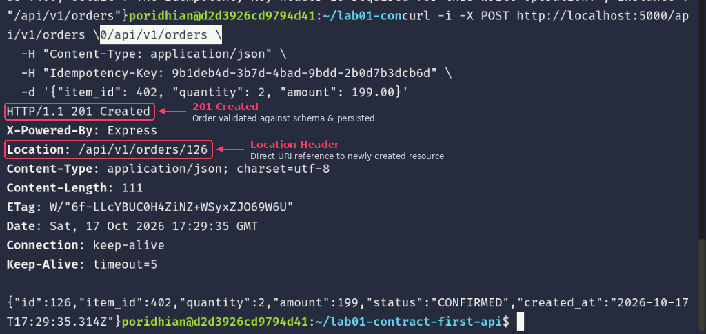
</p>

Expected output:

```text
HTTP/1.1 201 Created
Location: /api/v1/orders/126
Content-Type: application/json; charset=utf-8

{
  "id": 126,
  "item_id": 402,
  "quantity": 2,
  "amount": 199,
  "status": "CONFIRMED",
  "created_at": "2026-10-02T02:00:00.000Z"
}
```

### Scenario 3: Query Parameter Limit Out of Bounds (Expected 400 Bad Request)

Query `/api/v1/orders` with `limit=100`, exceeding the contract maximum of 50:

```bash
curl -i "http://localhost:5000/api/v1/orders?limit=100"
```

<p align="center">
  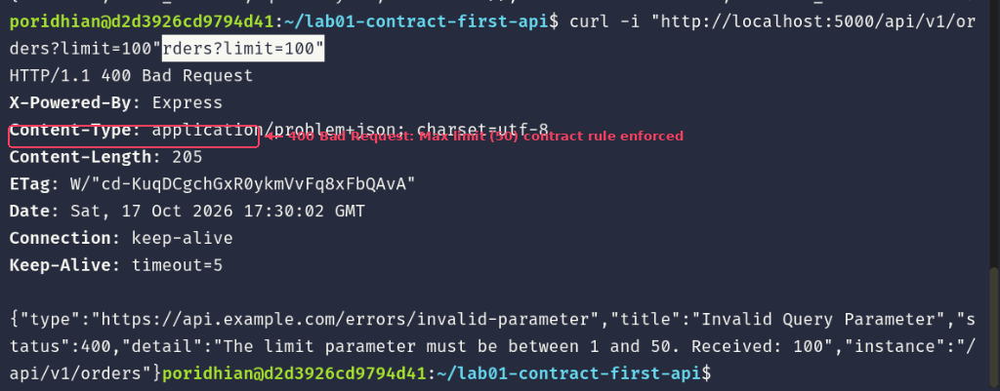
</p>

Expected output:

```text
HTTP/1.1 400 Bad Request
Content-Type: application/problem+json; charset=utf-8

{
  "type": "https://api.example.com/errors/invalid-parameter",
  "title": "Invalid Query Parameter",
  "status": 400,
  "detail": "The limit parameter must be between 1 and 50. Received: 100",
  "instance": "/api/v1/orders"
}
```

### Scenario 4: Cursor-Based Pagination

Retrieve the first page with `limit=3`:

```bash
curl -s "http://localhost:5000/api/v1/orders?limit=3" | jq .
```

<p align="center">
  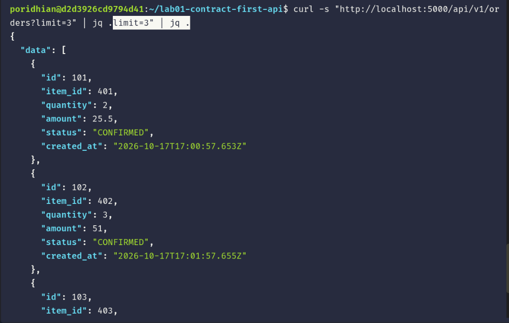
</p>

Expected output:

```json
{
  "data": [
    { "id": 101, "item_id": 401, "quantity": 2, "amount": 25.5, "status": "CONFIRMED" },
    { "id": 102, "item_id": 402, "quantity": 3, "amount": 51, "status": "CONFIRMED" },
    { "id": 103, "item_id": 403, "quantity": 1, "amount": 76.5, "status": "CONFIRMED" }
  ],
  "pagination": {
    "next_cursor": 103,
    "has_more": true,
    "count": 3
  }
}
```

Retrieve the second page using `cursor=103`:

```bash
curl -s "http://localhost:5000/api/v1/orders?limit=3&cursor=103" | jq .
```

<p align="center">
  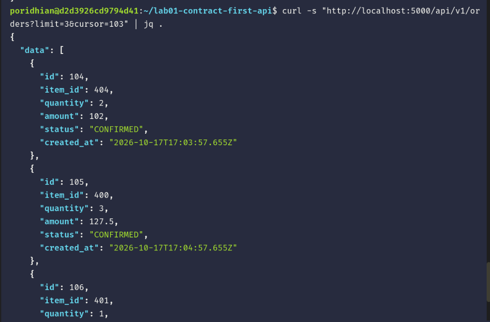
</p>

Expected output:

```json
{
  "data": [
    { "id": 104, "item_id": 404, "quantity": 2, "amount": 102, "status": "CONFIRMED" },
    { "id": 105, "item_id": 400, "quantity": 3, "amount": 127.5, "status": "CONFIRMED" },
    { "id": 106, "item_id": 401, "quantity": 1, "amount": 153, "status": "CONFIRMED" }
  ],
  "pagination": {
    "next_cursor": 106,
    "has_more": true,
    "count": 3
  }
}
```

---

### Scenario 5: Automated Contract Validation Test Suite

Create a file named `test.js` with the following contents:

```javascript
const http = require('http');
const app = require('./server');

const server = app.listen(0, async () => {
  const port = server.address().port;
  const baseUrl = `http://localhost:${port}`;
  console.log(`[TEST RUNNER] Running contract verification against port ${port}...\n`);

  function request(method, path, headers = {}, body = null) {
    return new Promise((resolve, reject) => {
      const url = new URL(path, baseUrl);
      const req = http.request(url, {
        method,
        headers: {
          'Content-Type': 'application/json',
          ...headers
        }
      }, (res) => {
        let data = '';
        res.on('data', chunk => data += chunk);
        res.on('end', () => {
          let parsed = null;
          try { parsed = JSON.parse(data); } catch(e) { parsed = data; }
          resolve({ status: res.statusCode, headers: res.headers, body: parsed });
        });
      });
      req.on('error', reject);
      if (body) req.write(JSON.stringify(body));
      req.end();
    });
  }

  try {
    // Test 1: Missing Idempotency-Key on POST -> Expect 400 Problem Details
    console.log('Test 1: Asserting 400 Bad Request when Idempotency-Key header is omitted...');
    const res1 = await request('POST', '/api/v1/orders', {}, { item_id: 1, quantity: 2, amount: 50.0 });
    if (res1.status === 400 && res1.body.title === 'Missing Required Header') {
      console.log(' PASS: 400 RFC 7807 returned properly for missing header.\n');
    } else {
      throw new Error(`Test 1 Failed: Received status ${res1.status}`);
    }

    // Test 2: Valid Order Creation with Idempotency-Key -> Expect 201 Created
    console.log('Test 2: Creating an order with valid schema and Idempotency-Key...');
    const res2 = await request('POST', '/api/v1/orders', { 'Idempotency-Key': '9b1deb4d-3b7d-4bad-9bdd-2b0d7b3dcb6d' }, {
      item_id: 402,
      quantity: 3,
      amount: 199.99
    });
    if (res2.status === 201 && res2.body.id && res2.headers.location) {
      console.log(` PASS: 201 Created returned. Order ID: ${res2.body.id}, Location: ${res2.headers.location}\n`);
    } else {
      throw new Error(`Test 2 Failed: Received status ${res2.status}`);
    }

    // Test 3: Pagination Limit Out of Bounds (limit > 50) -> Expect 400 Problem Details
    console.log('Test 3: Requesting pagination limit=100 (exceeding max 50 contract rule)...');
    const res3 = await request('GET', '/api/v1/orders?limit=100');
    if (res3.status === 400 && res3.body.title === 'Invalid Query Parameter') {
      console.log(' PASS: 400 RFC 7807 returned for limit out of bounds.\n');
    } else {
      throw new Error(`Test 3 Failed: Received status ${res3.status}`);
    }

    // Test 4: Cursor-based Pagination Retrieval -> Expect 200 OK with next_cursor
    console.log('Test 4: Querying first page of orders (limit=5)...');
    const res4 = await request('GET', '/api/v1/orders?limit=5');
    if (res4.status === 200 && res4.body.data.length === 5 && res4.body.pagination.next_cursor) {
      const nextCursor = res4.body.pagination.next_cursor;
      console.log(` PASS: Page 1 returned 5 items. Next cursor token: ${nextCursor}`);

      console.log(`Querying Page 2 using cursor=${nextCursor}...`);
      const res5 = await request('GET', `/api/v1/orders?limit=5&cursor=${nextCursor}`);
      if (res5.status === 200 && res5.body.data.length === 5 && res5.body.data[0].id > nextCursor) {
        console.log(` PASS: Page 2 returned next 5 items without overlap. First item ID: ${res5.body.data[0].id}\n`);
      } else {
        throw new Error('Test 4 Page 2 Failed');
      }
    } else {
      throw new Error(`Test 4 Failed: Received status ${res4.status}`);
    }

    console.log(' ALL 4 CONTRACT-FIRST API TESTS PASSED SUCCESSFULLY!');
  } catch (err) {
    console.error('Test suite failed:', err);
    process.exitCode = 1;
  } finally {
    server.close();
  }
});
```

<p align="center">
  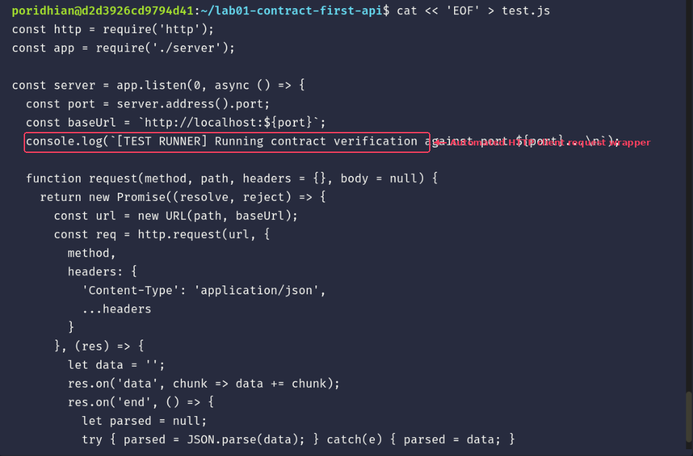
</p>

**Explanation:**
- `app.listen(0)`: Spawns the Express server on an ephemeral random port to isolate automated tests from active server instances.
- `request()`: Wraps Node.js `http.request` into a promise-based client to test status codes, headers, and parsed JSON responses.
- `Test 1`: Asserts that omitting `Idempotency-Key` triggers an `HTTP 400` status with RFC 7807 payload title `Missing Required Header`.
- `Test 2`: Asserts that supplying a valid body and key produces `HTTP 201 Created` with a populated `Location` header.
- `Test 3`: Asserts that requesting `limit=100` triggers `HTTP 400 Bad Request` with `Invalid Query Parameter`.
- `Test 4`: Asserts that sequential queries across pages yield distinct records without ID overlap using `next_cursor`.

Execute `npm test` to run the test suite:

```bash
npm test
```

<p align="center">
  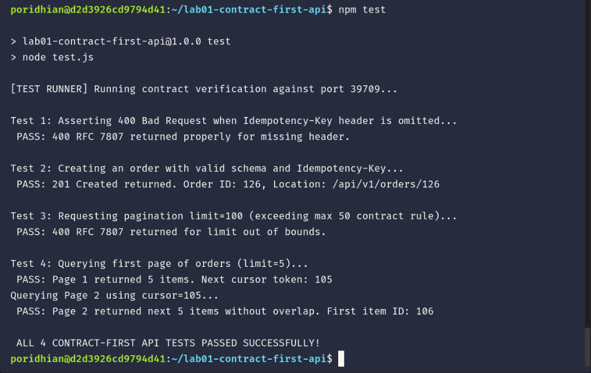
</p>

Expected output:

```text
> lab01-contract-first-api@1.0.0 test
> node test.js

[TEST RUNNER] Running contract verification against port 39707...

Test 1: Asserting 400 Bad Request when Idempotency-Key header is omitted...
 PASS: 400 RFC 7807 returned properly for missing header.

Test 2: Creating an order with valid schema and Idempotency-Key...
 PASS: 201 Created returned. Order ID: 126, Location: /api/v1/orders/126

Test 3: Requesting pagination limit=100 (exceeding max 50 contract rule)...
 PASS: 400 RFC 7807 returned for limit out of bounds.

Test 4: Querying first page of orders (limit=5)...
 PASS: Page 1 returned 5 items. Next cursor token: 105
Querying Page 2 using cursor=105...
 PASS: Page 2 returned next 5 items without overlap. First item ID: 106

 ALL 4 CONTRACT-FIRST API TESTS PASSED SUCCESSFULLY!
```

---

## Conclusion

You designed an OpenAPI 3.0.3 specification enforcing URI versioning, write idempotency headers, query boundaries, and RFC 7807 Problem Details. You implemented an Express server stub directly compliant with this contract and verified boundary enforcement, cursor pagination, and error responses through cURL and automated test suites.
