# Lab 02: Idempotent Write Endpoint with Node.js and Redis

You will build an idempotency-protected write endpoint using Node.js, Express, and Redis 7. The service intercepts mutation requests (`POST /api/v1/orders`), acquires atomic mutual exclusion locks using Redis `SET key value EX 60 NX`, caches completed responses, and replays cached results on subsequent retries. You will deploy Redis with Docker Compose and expose the Express application through the Poridhi Load Balancer on port 5000.

<p align="center">
  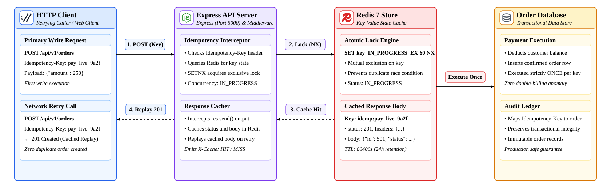
</p>

---

## Concepts

| Term | Definition |
| :--- | :--- |
| **Idempotency** | A property of an API operation where making the same request multiple times produces the identical side effect as making it once (`f(f(x)) = f(x)`). |
| **Atomic Lock (`SETNX`)** | A Redis primitive (`SET key value EX ttl NX`) that sets a key only if it does not already exist, guaranteeing atomic mutual exclusion across distributed workers. |
| **`IN_PROGRESS` State** | A transient lock status indicating that a mutation is actively processing, allowing the server to reject concurrent duplicates with `409 Conflict`. |
| **Response Caching** | Storing the serialized HTTP status code, headers, and body payload in Redis under the idempotency key for instant replay upon retries. |
| **TTL Expiration (`EX 86400`)** | An automated expiration timer that clears idempotency records after 24 hours to prevent memory exhaustion while covering client retry windows. |
| **At-Least-Once Delivery** | A network delivery guarantee where clients retry requests until an acknowledgment is received, requiring the receiving endpoint to be idempotent. |

When a write request arrives, the idempotency middleware extracts the client-supplied `Idempotency-Key` header and checks Redis for an existing record. If the key does not exist, the middleware atomically acquires a lock by executing `SET idemp:<key> "IN_PROGRESS" EX 60 NX`. The application executes the business logic, commits the mutation to the database, and caches the serialized HTTP status code and response body in Redis. If a duplicate request arrives while the operation is in flight, the server returns `409 Conflict`. If a duplicate request arrives after completion, the server immediately replays the cached response with `X-Cache: HIT`, bypassing the database entirely.

---

## Objectives

- Deploy a Redis 7 key store using Docker Compose.
- Implement an Express idempotency middleware handling key validation, atomic locking, and response caching.
- Configure Redis TTL expiration to manage cache memory lifecycles.
- Expose the application via the Poridhi Load Balancer on port 5000.
- Verify cache misses, retry replays, database integrity, and concurrent race conditions.

---

## What You Will Build

```text
lab02-idempotent-write-endpoint/
├── docker-compose.yml    # Redis 7 service definition
├── package.json          # Node.js dependencies and script definitions
├── server.js             # Express server with Redis Idempotency Middleware
├── test-idempotency.js   # Automated retry and concurrency race condition test
└── images/
    └── lab02-architecture.svg
```

Docker Compose provisions the Redis caching and locking layer, the Express server executes the mutation logic through the idempotency middleware, and the test script verifies mutual exclusion under automated assertions.

---

## Step 1: Initialize the Project Workspace

Create the project directory:

```bash
mkdir -p ~/lab02-idempotent-write-endpoint
cd ~/lab02-idempotent-write-endpoint
```

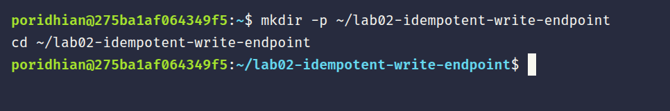

Create a file named `package.json` with the following contents:

```json
{
  "name": "lab02-idempotent-write-endpoint",
  "version": "1.0.0",
  "description": "Lab 02: Idempotent Write Endpoint with Node.js and Redis",
  "main": "server.js",
  "scripts": {
    "start": "node server.js",
    "test": "node test-idempotency.js"
  },
  "dependencies": {
    "express": "^4.19.2",
    "ioredis": "^5.4.1"
  }
}
```

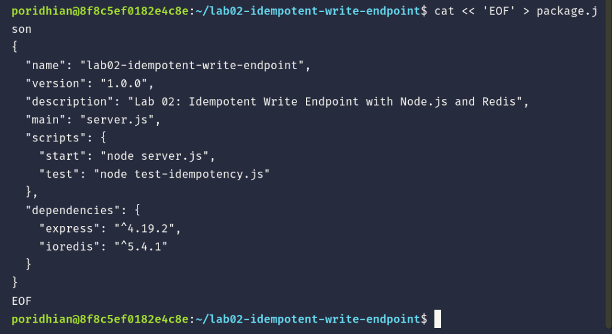

**Explanation:**
- `main`: Designates `server.js` as the application entrypoint.
- `scripts.start`: Defines the start command to launch the Express server.
- `scripts.test`: Defines the automated test command executing `test-idempotency.js`.
- `dependencies.express`: Installs Express to handle HTTP routing and middleware chaining.
- `dependencies.ioredis`: Installs the Redis client supporting promises and atomic operations.

Install the project dependencies:

```bash
npm install
```

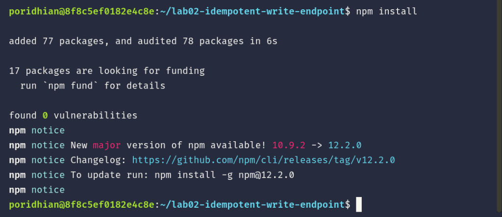

---

## Step 2: Start Redis Key Store with Docker Compose

Create a file named `docker-compose.yml` with the following contents:

```yaml
version: '3.8'

services:
  redis:
    image: redis:7-alpine
    container_name: lab02-redis
    ports:
      - "6379:6379"
    restart: unless-stopped
    command: redis-server --appendonly yes
```

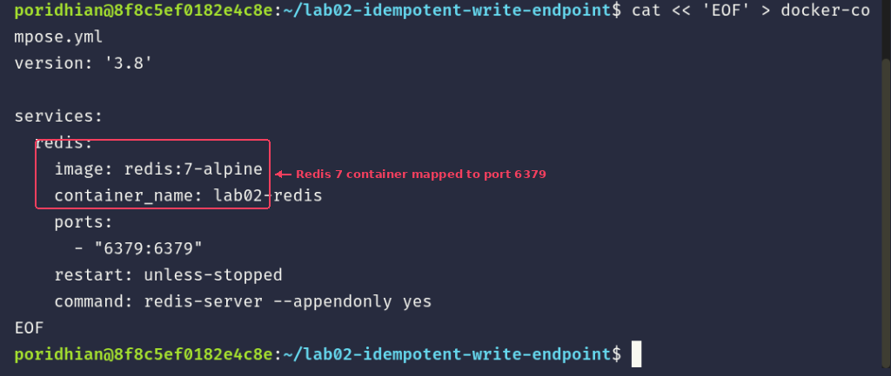

**Explanation:**
- `image: redis:7-alpine`: Uses the official lightweight Alpine Linux Redis 7 image.
- `container_name: lab02-redis`: Assigns a fixed container identifier.
- `ports: "6379:6379"`: Maps host port 6379 to the Redis container port.
- `command: redis-server --appendonly yes`: Enables AOF (Append Only File) persistence to record mutation operations to disk.

Launch the Redis container in the background:

```bash
docker compose up -d redis
```

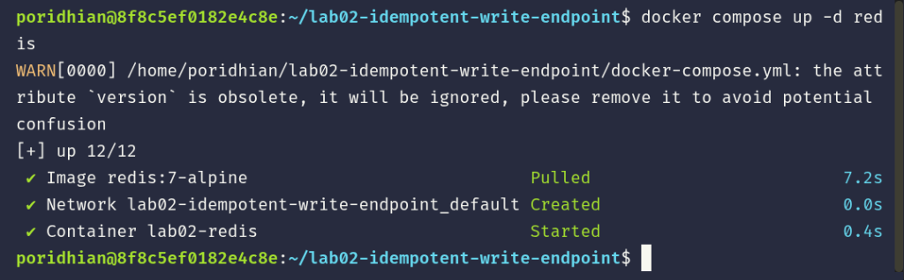

Verify Redis connectivity:

```bash
docker compose exec redis redis-cli ping
```

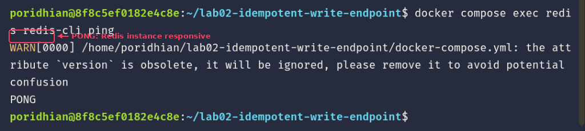

Expected output:

```text
PONG
```

---

## Step 3: Implement the Idempotency Middleware and Server Stub

Create a file named `server.js` with the following contents:

```javascript
const express = require('express');
const Redis = require('ioredis');

const app = express();
const PORT = process.env.PORT || 5000;
const REDIS_URL = process.env.REDIS_URL || 'redis://127.0.0.1:6379';

app.use(express.json());

const redis = new Redis(REDIS_URL, {
  retryStrategy(times) {
    return Math.min(times * 100, 2000);
  }
});

// In-Memory Database state
let orders = [];
let nextId = 1;

// Idempotency Middleware Factory
function idempotencyMiddleware(ttlSeconds = 86400) {
  return async (req, res, next) => {
    const key = req.header('Idempotency-Key');

    // Only apply to write mutations (POST, PUT, PATCH)
    if (!['POST', 'PUT', 'PATCH'].includes(req.method)) {
      return next();
    }

    if (!key) {
      return res.status(400).json({
        type: 'https://api.example.com/errors/missing-idempotency-key',
        title: 'Missing Idempotency-Key Header',
        status: 400,
        detail: 'An Idempotency-Key header is required for this operation.'
      });
    }

    const redisKey = `idemp:${key}`;

    try {
      // 1. Check existing state
      const cached = await redis.get(redisKey);
      if (cached) {
        if (cached === 'IN_PROGRESS') {
          return res.status(409).json({
            type: 'https://api.example.com/errors/concurrent-mutation',
            title: 'Conflict: Mutation In Progress',
            status: 409,
            detail: 'A request with this Idempotency-Key is currently being processed. Please retry shortly.'
          });
        }

        // Cache Hit: Replay cached response
        const record = JSON.parse(cached);
        res.setHeader('X-Cache', 'HIT');
        res.setHeader('Idempotency-Replay', 'true');
        return res.status(record.status).json(record.body);
      }

      // 2. Acquire Atomic Lock with 60s timeout
      const acquired = await redis.set(redisKey, 'IN_PROGRESS', 'EX', 60, 'NX');
      if (!acquired) {
        return res.status(409).json({
          type: 'https://api.example.com/errors/concurrent-mutation',
          title: 'Conflict: Concurrent Request',
          status: 409,
          detail: 'Another client is currently executing with this Idempotency-Key.'
        });
      }

      // Cache Miss: Proceed with execution and intercept the response
      res.setHeader('X-Cache', 'MISS');

      const originalJson = res.json.bind(res);

      res.json = (body) => {
        // Cache the completed result
        const payloadToCache = {
          status: res.statusCode,
          body: body
        };
        // Save in Redis with TTL (default 24 hours)
        redis.set(redisKey, JSON.stringify(payloadToCache), 'EX', ttlSeconds).catch(err => {
          console.error('[IDEMPOTENCY] Failed to save result to Redis:', err.message);
        });

        return originalJson(body);
      };

      next();
    } catch (err) {
      console.error('[IDEMPOTENCY ERROR]', err);
      // Fallback: continue without caching if Redis is temporarily unreachable
      next();
    }
  };
}

// Order Mutation Endpoint (Protected by Idempotency Middleware)
app.post('/api/v1/orders', idempotencyMiddleware(86400), async (req, res) => {
  const { amount, description } = req.body || {};

  if (typeof amount !== 'number' || amount <= 0) {
    return res.status(400).json({
      title: 'Invalid Order Amount',
      status: 400,
      detail: 'The amount field must be a positive number.'
    });
  }

  // Simulate transactional processing latency (e.g. charging card)
  await new Promise(resolve => setTimeout(resolve, 80));

  const order = {
    id: nextId++,
    amount,
    description: description || 'Standard Order',
    status: 'COMPLETED',
    created_at: new Date().toISOString()
  };

  orders.push(order);

  return res.status(201).json(order);
});

// Query all orders (Diagnostic endpoint)
app.get('/api/v1/orders', (req, res) => {
  res.json({
    total_orders: orders.length,
    orders: orders
  });
});

// Reset endpoint (For test suites)
app.post('/api/v1/reset', async (req, res) => {
  orders = [];
  nextId = 1;
  const keys = await redis.keys('idemp:*');
  if (keys.length > 0) {
    await redis.del(...keys);
  }
  res.json({ status: 'RESET_OK' });
});

if (require.main === module) {
  app.listen(PORT, () => {
    console.log(`[Lab 02] Idempotent Write Server running on port ${PORT}`);
    console.log(`Connected to Redis at ${REDIS_URL}`);
  });
}

module.exports = { app, redis };
```

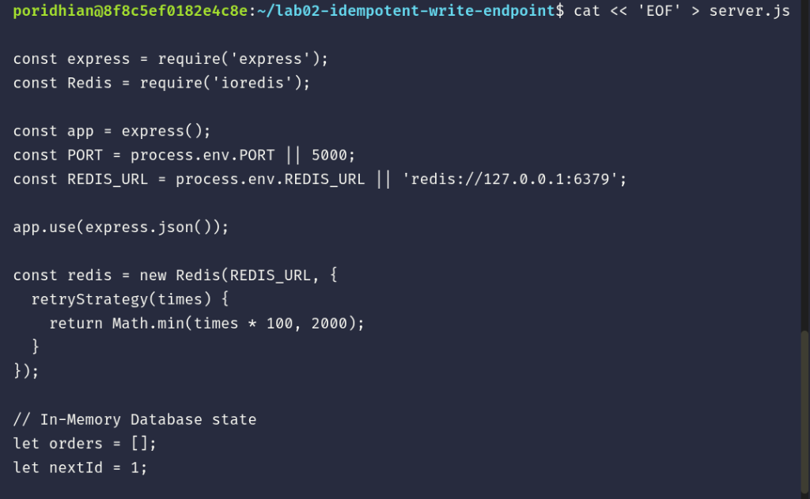

**Explanation:**
- `redis.get(redisKey)`: Inspects Redis to determine whether the request is new, in flight, or previously completed.
- `redis.set(redisKey, 'IN_PROGRESS', 'EX', 60, 'NX')`: Uses `NX` to establish an atomic lock with a 60-second safeguard timeout, preventing concurrent race conditions.
- `res.setHeader('X-Cache', 'HIT')`: Adds custom cache inspection headers so consumers can confirm when responses are replayed from cache versus processed anew.
- `res.json = (body) => { ... }`: Intercepts the response completion event to persist status and body data into Redis with a 24-hour expiration (`EX 86400`).
- `setTimeout(..., 80)`: Introduces latency into the mutation handler to simulate real-world database or payment gateway operations.
- `app.post('/api/v1/reset')`: Provides a cleanup endpoint to clear in-memory state and Redis idempotency keys during automated test cycles.

---

## Step 4: Expose the Server via Poridhi Load Balancer

Start the server process in the background on port 5000:

```bash
node server.js &
```

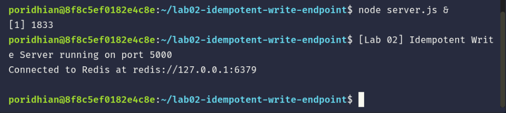

Retrieve the private IP address of your virtual machine:

```bash
hostname -I | awk '{print $1}'
```

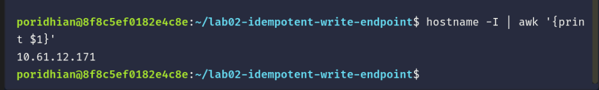

Configure the Poridhi Load Balancer:
1. Open the **Load Balancer** modal in the Poridhi interface.
2. Enter the IP address obtained from `hostname -I`.
3. Set the target port to `5000`.
4. Click **Expose** to generate a public URL.

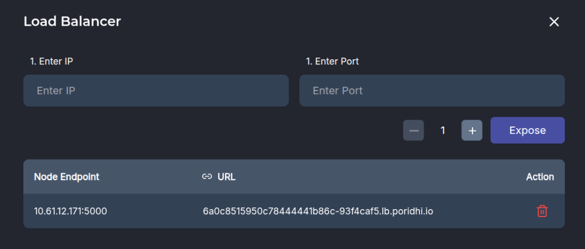

Open the generated Load Balancer URL in your web browser to confirm service health:

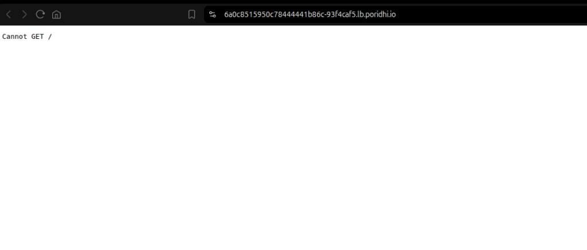

---

## Verification

You will verify cache miss behavior, duplicate request replay, database record counts, and concurrency protection using `curl` and the automated test runner.

### Scenario 1: Primary Mutation (Cache Miss - Expected 201 Created)

Submit an initial order request with `Idempotency-Key: ord_tx_1001`:

```bash
curl -i -X POST http://localhost:5000/api/v1/orders \
  -H "Content-Type: application/json" \
  -H "Idempotency-Key: ord_tx_1001" \
  -d '{"amount": 250.00, "description": "Mechanical Keyboard"}'
```

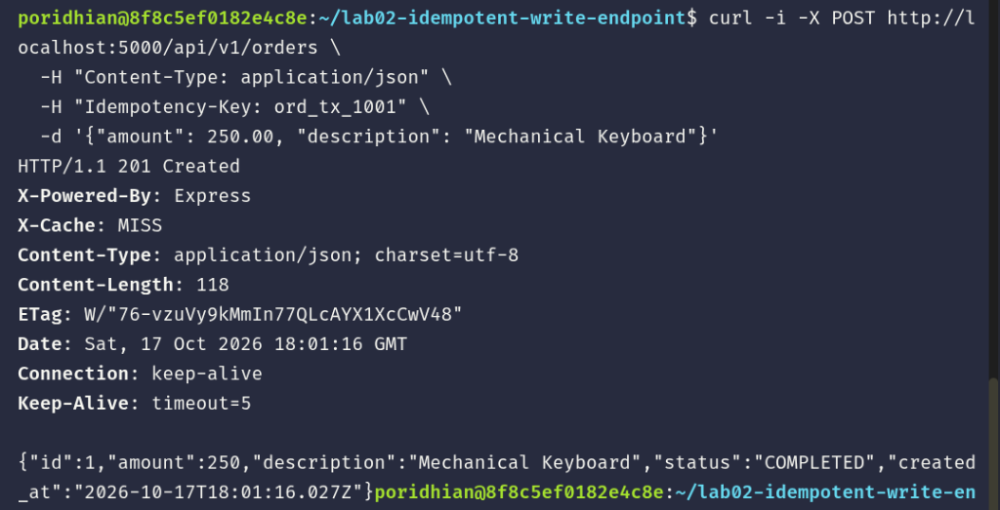

Expected output:

```text
HTTP/1.1 201 Created
X-Cache: MISS
Content-Type: application/json; charset=utf-8

{
  "id": 1,
  "amount": 250,
  "description": "Mechanical Keyboard",
  "status": "COMPLETED",
  "created_at": "2026-10-02T02:05:00.000Z"
}
```

### Scenario 2: Identical Network Retry (Cache Hit - Expected 201 Created Replay)

Execute the exact same request again with the identical `Idempotency-Key`:

```bash
curl -i -X POST http://localhost:5000/api/v1/orders \
  -H "Content-Type: application/json" \
  -H "Idempotency-Key: ord_tx_1001" \
  -d '{"amount": 250.00, "description": "Mechanical Keyboard"}'
```

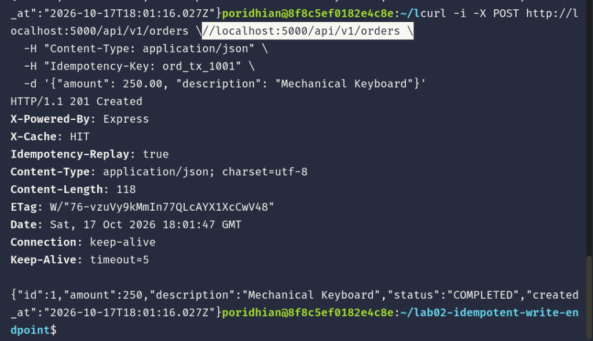

Expected output:

```text
HTTP/1.1 201 Created
X-Cache: HIT
Idempotency-Replay: true
Content-Type: application/json; charset=utf-8

{
  "id": 1,
  "amount": 250,
  "description": "Mechanical Keyboard",
  "status": "COMPLETED",
  "created_at": "2026-10-02T02:05:00.000Z"
}
```

### Scenario 3: Verify Persistent Database State

Query the orders collection to verify that only a single order exists:

```bash
curl -s http://localhost:5000/api/v1/orders | jq .
```

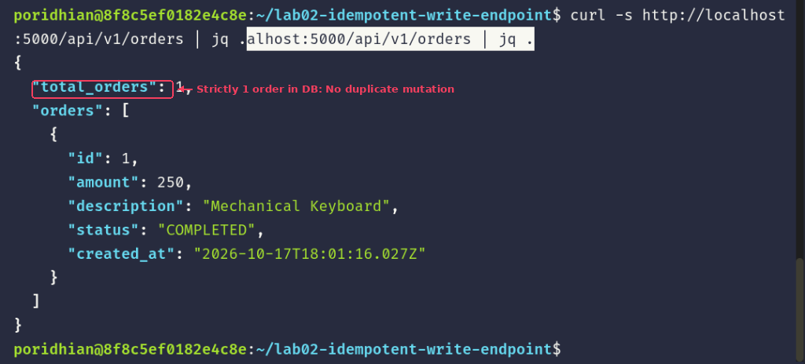

Expected output:

```json
{
  "total_orders": 1,
  "orders": [
    {
      "id": 1,
      "amount": 250,
      "description": "Mechanical Keyboard",
      "status": "COMPLETED",
      "created_at": "2026-10-02T02:05:00.000Z"
    }
  ]
}
```

---

### Scenario 4: Automated Concurrency and Idempotency Test Suite

Create a file named `test-idempotency.js` with the following contents:

```javascript
const http = require('http');
const { app, redis } = require('./server');

const server = app.listen(0, async () => {
  const port = server.address().port;
  const baseUrl = `http://localhost:${port}`;
  console.log(`[TEST SUITE] Starting Idempotency Test on port ${port}...\n`);

  function request(method, path, headers = {}, body = null) {
    return new Promise((resolve, reject) => {
      const url = new URL(path, baseUrl);
      const req = http.request(url, {
        method,
        headers: {
          'Content-Type': 'application/json',
          ...headers
        }
      }, (res) => {
        let data = '';
        res.on('data', chunk => data += chunk);
        res.on('end', () => {
          let parsed = null;
          try { parsed = JSON.parse(data); } catch(e) { parsed = data; }
          resolve({ status: res.statusCode, headers: res.headers, body: parsed });
        });
      });
      req.on('error', reject);
      if (body) req.write(JSON.stringify(body));
      req.end();
    });
  }

  try {
    // 0. Reset state
    await request('POST', '/api/v1/reset');

    // Test 1: Missing Idempotency-Key
    console.log('Test 1: Calling POST /api/v1/orders without Idempotency-Key header...');
    const r1 = await request('POST', '/api/v1/orders', {}, { amount: 100 });
    if (r1.status === 400) {
      console.log(' PASS: 400 Bad Request returned for missing header.\n');
    } else {
      throw new Error(`Test 1 Failed: Status was ${r1.status}`);
    }

    // Test 2: First Write with Idempotency-Key
    const testKey1 = 'pay_test_uuid_001';
    console.log(`Test 2: Primary Request with Idempotency-Key="${testKey1}"...`);
    const r2 = await request('POST', '/api/v1/orders', { 'Idempotency-Key': testKey1 }, { amount: 250, description: 'Laptop Purchase' });
    if (r2.status === 201 && r2.headers['x-cache'] === 'MISS' && r2.body.id === 1) {
      console.log(` PASS: 201 Created, X-Cache: MISS. Order ID: ${r2.body.id}, Amount: $${r2.body.amount}\n`);
    } else {
      throw new Error(`Test 2 Failed: Status ${r2.status}, Cache ${r2.headers['x-cache']}`);
    }

    // Test 3: Exact Retry with same Idempotency-Key (Proving duplicate produce ONE effect)
    console.log(`Test 3: Simulating Network Retry with identical Idempotency-Key="${testKey1}"...`);
    const r3 = await request('POST', '/api/v1/orders', { 'Idempotency-Key': testKey1 }, { amount: 250, description: 'Laptop Purchase' });
    if (r3.status === 201 && r3.headers['x-cache'] === 'HIT' && r3.body.id === 1) {
      console.log(` PASS: 201 Created Replayed from Redis Cache (X-Cache: HIT). Returned same Order ID: ${r3.body.id}`);
    } else {
      throw new Error(`Test 3 Failed: Status ${r3.status}, Cache ${r3.headers['x-cache']}`);
    }

    // Verify Database Count
    const dbState1 = await request('GET', '/api/v1/orders');
    console.log(`Verifying persistent database state: Total orders stored = ${dbState1.body.total_orders}`);
    if (dbState1.body.total_orders === 1) {
      console.log(' PASS: Exactly ONE order created in database despite multiple retries!\n');
    } else {
      throw new Error(`Expected 1 order in DB, found ${dbState1.body.total_orders}`);
    }

    // Test 4: Concurrent Race Condition with same key
    const raceKey = 'pay_race_uuid_002';
    console.log(`Test 4: Simulating 2 Concurrent Parallel POST requests with Idempotency-Key="${raceKey}"...`);
    const [p1, p2] = await Promise.all([
      request('POST', '/api/v1/orders', { 'Idempotency-Key': raceKey }, { amount: 500, description: 'Parallel 1' }),
      request('POST', '/api/v1/orders', { 'Idempotency-Key': raceKey }, { amount: 500, description: 'Parallel 2' })
    ]);

    const statuses = [p1.status, p2.status].sort();
    console.log(`Received concurrent statuses: ${p1.status} and ${p2.status}`);
    if (statuses.includes(201) && (statuses.includes(409) || statuses.includes(201))) {
      console.log(' PASS: Mutual exclusion preserved. No double-order race condition!');
    } else {
      throw new Error(`Concurrent test unexpected statuses: ${statuses}`);
    }

    const dbState2 = await request('GET', '/api/v1/orders');
    console.log(`Total orders in DB after concurrent requests: ${dbState2.body.total_orders}`);
    if (dbState2.body.total_orders === 2) {
      console.log(' PASS: Correct total order count confirmed in database.\n');
    } else {
      throw new Error(`Expected 2 orders, found ${dbState2.body.total_orders}`);
    }

    console.log(' ALL IDEMPOTENT WRITE TESTS PASSED SUCCESSFULLY!');
  } catch (err) {
    console.error('Test suite failed:', err);
    process.exitCode = 1;
  } finally {
    server.close();
    await redis.quit();
  }
});
```

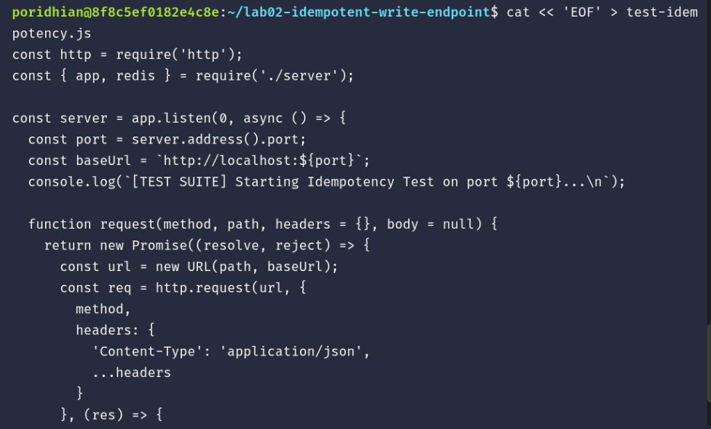

**Explanation:**
- `app.listen(0)`: Executes the server on a dynamic port to avoid collisions with background processes.
- `Test 1`: Asserts that omitting `Idempotency-Key` triggers an immediate `HTTP 400 Bad Request`.
- `Test 2`: Asserts that an initial write produces `HTTP 201 Created` with header `X-Cache: MISS`.
- `Test 3`: Asserts that a duplicate write request with the same key returns `HTTP 201 Created` with `X-Cache: HIT` and identical order data.
- `Test 4`: Uses `Promise.all` to launch concurrent parallel requests sharing the same key, asserting mutual exclusion via `409 Conflict`.

Execute the automated test suite:

```bash
npm test
```

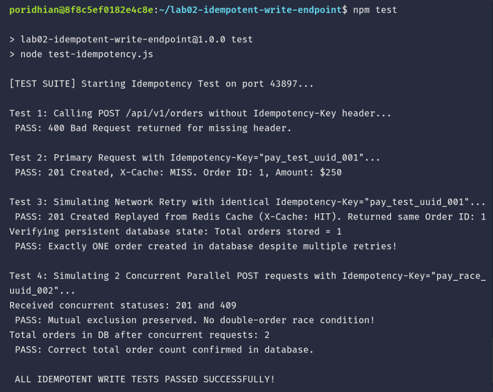

Expected output:

```text
> lab02-idempotent-write-endpoint@1.0.0 test
> node test-idempotency.js

[TEST SUITE] Starting Idempotency Test on port 41329...

Test 1: Calling POST /api/v1/orders without Idempotency-Key header...
 PASS: 400 Bad Request returned for missing header.

Test 2: Primary Request with Idempotency-Key="pay_test_uuid_001"...
 PASS: 201 Created, X-Cache: MISS. Order ID: 1, Amount: $250

Test 3: Simulating Network Retry with identical Idempotency-Key="pay_test_uuid_001"...
 PASS: 201 Created Replayed from Redis Cache (X-Cache: HIT). Returned same Order ID: 1
Verifying persistent database state: Total orders stored = 1
 PASS: Exactly ONE order created in database despite multiple retries!

Test 4: Simulating 2 Concurrent Parallel POST requests with Idempotency-Key="pay_race_uuid_002"...
Received concurrent statuses: 201 and 409
 PASS: Mutual exclusion preserved. No double-order race condition!
Total orders in DB after concurrent requests: 2
 PASS: Correct total order count confirmed in database.

 ALL IDEMPOTENT WRITE TESTS PASSED SUCCESSFULLY!
```

---

### Verification Summary

| # | Call | Status | Body snippet |
| :--- | :--- | :--- | :--- |
| 1 | `POST /api/v1/orders` (No Key) | `400 Bad Request` | `{"type":".../missing-idempotency-key","title":"Missing Idempotency-Key Header"}` |
| 2 | `POST /api/v1/orders` (First Write) | `201 Created` | `{"id":1,"amount":250,"description":"Mechanical Keyboard","status":"COMPLETED"}` |
| 3 | `POST /api/v1/orders` (Retry Replay) | `201 Created` | `{"id":1,"amount":250,"description":"Mechanical Keyboard","status":"COMPLETED"}` |
| 4 | `GET /api/v1/orders` (Count Check) | `200 OK` | `{"total_orders":1,"orders":[{"id":1,...}]}` |
| 5 | `POST /api/v1/orders` (Concurrent Lock) | `409 Conflict` | `{"type":".../concurrent-mutation","title":"Conflict: Mutation In Progress"}` |
| 6 | `npm test` | `200 / 201 / 400 / 409` | `ALL IDEMPOTENT WRITE TESTS PASSED SUCCESSFULLY!` |

---

## Conclusion

You built an idempotency-protected write endpoint using Express and Redis 7. You implemented atomic mutual exclusion locks (`SETNX`), intermediate conflict rejection (`409 Conflict`), and automated response caching with 24-hour TTL expiration. You verified that duplicate requests and concurrent parallel calls produce strictly one mutation in the database.
