# Lab 03: API Gateway & Rate-Aware Routing with Nginx

You will build an API gateway using Nginx and Docker Compose fronting two isolated Node.js microservices (`orders-service` and `users-service`). The gateway handles edge authentication using declarative `map` blocks, enforces token-bucket rate limiting (`5 req/s` with burst buffers), and dynamically routes client traffic to private upstream containers. You will deploy the multi-container stack and expose the gateway via the Poridhi Load Balancer on port 8080.

<p align="center">
  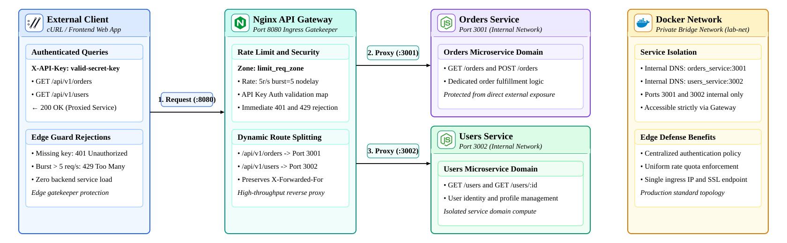
</p>

---

## Concepts

| Term | Definition |
| :--- | :--- |
| **API Gateway** | A reverse proxy server providing a centralized entry point for client requests, handling authentication, traffic shaping, and routing. |
| **Reverse Proxy** | An intermediate server receiving public client traffic and dispatching it to private internal services, concealing internal network topology. |
| **Token Bucket Rate Limiting** | An algorithm implemented via Nginx `limit_req_zone` that regulates sustained traffic rates while permitting controlled short-term bursts. |
| **Edge Authentication** | The practice of validating caller credentials at the gateway perimeter before requests reach internal downstream application compute. |
| **Declarative `map` Block** | An in-memory hash table lookup mechanism in Nginx that maps request variables (`$http_x_api_key`) to client identities with $O(1)$ efficiency. |
| **Private Bridge Network** | A Docker container network (`lab-net`) where microservices communicate via internal DNS names without publishing ports to the host. |

Incoming HTTP traffic enters Nginx on port 80. Nginx first evaluates the `X-API-Key` header against a memory-mapped lookup table. If the key is missing or invalid, Nginx immediately drops the request with `401 Unauthorized` without waking downstream containers. For authenticated traffic, Nginx checks compliance against a 10MB token-bucket rate limit zone (`5 req/s`). Requests within the rate boundary are reverse-proxied across the private Docker network to `orders_service:3001` or `users_service:3002`. If request rates exceed the token buffer, Nginx throttles the excess traffic with `429 Too Many Requests`.

<p align="center">
  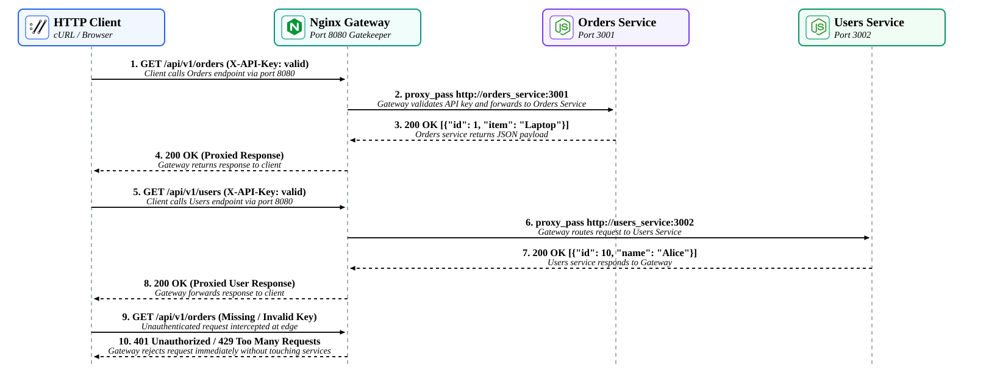
</p>

---

## Objectives

- Configure isolated Node.js microservices for orders and users on private internal ports.
- Implement an Nginx API Gateway with declarative API key verification and token-bucket rate limiting.
- Assemble a multi-container Docker Compose network with zero host port exposure for backend services.
- Expose the gateway through the Poridhi Load Balancer on port 8080.
- Verify health checks, edge authentication rejections, dynamic routing, and rate limit throttling.

---

## What You Will Build

```text
lab03-gateway-routing/
├── docker-compose.yml       # Docker Compose multi-container stack
├── nginx.conf               # Nginx API Gateway config (Auth + Rate Quotas + Routing)
├── services/
│   ├── orders-service/
│   │   ├── package.json
│   │   └── server.js        # Internal Orders Microservice (Port 3001)
│   └── users-service/
│       ├── package.json
│       └── server.js        # Internal Users Microservice (Port 3002)
└── verify-gateway.sh        # Automated cURL test script
```

The Nginx gateway serves as the single public entrypoint that authenticates requests and regulates rate limits before routing traffic to private microservices communicating across an isolated bridge network.

---

## Step 1: Initialize Project and Configure Microservices

Create the project directories:

```bash
mkdir -p ~/lab03-gateway-routing/services/orders-service
mkdir -p ~/lab03-gateway-routing/services/users-service
cd ~/lab03-gateway-routing
```

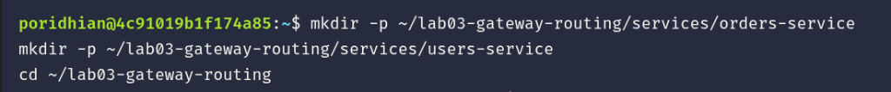

Create a file named `services/orders-service/package.json` with the following contents:

```json
{
  "name": "orders-service",
  "version": "1.0.0",
  "main": "server.js",
  "scripts": {
    "start": "node server.js"
  },
  "dependencies": {
    "express": "^4.19.2"
  }
}
```

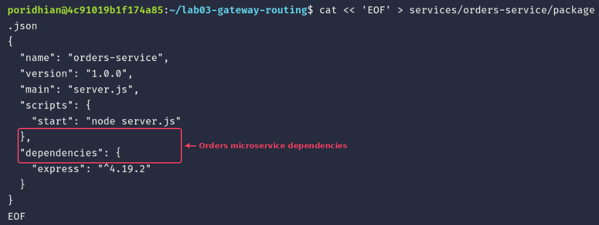

**Explanation:**
- `main`: Sets `server.js` as the entrypoint for the orders microservice.
- `scripts.start`: Defines the start script to execute the service with Node.js.
- `dependencies.express`: Installs Express for handling HTTP request routing.

Create a file named `services/orders-service/server.js` with the following contents:

```javascript
const express = require('express');
const app = express();
const PORT = process.env.PORT || 3001;

app.use(express.json());

const orders = [
  { id: 101, item: "Mechanical Keyboard", amount: 150.00, status: "CONFIRMED" },
  { id: 102, item: "Ultra-Wide Monitor", amount: 450.00, status: "SHIPPED" },
  { id: 103, item: "USB-C Docking Station", amount: 89.99, status: "PENDING" }
];

app.get('/api/v1/orders', (req, res) => {
  const clientName = req.header('X-Client-Name') || 'Unknown';
  console.log(`[ORDERS SERVICE] Query processed for client: ${clientName}`);
  res.json({
    service: "Orders Service",
    port: PORT,
    authenticated_client: clientName,
    count: orders.length,
    data: orders
  });
});

app.listen(PORT, '0.0.0.0', () => {
  console.log(`[Orders Service] Running on internal port ${PORT}`);
});
```

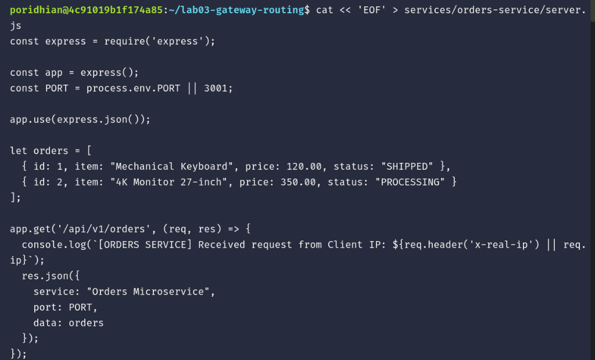

**Explanation:**
- `PORT = process.env.PORT || 3001`: Sets internal port 3001 for container network isolation.
- `req.header('X-Client-Name')`: Reads client metadata injected by Nginx during reverse-proxying.
- `app.listen(PORT, '0.0.0.0')`: Binds to all network interfaces within the container so Nginx can proxy traffic to it.

Create a file named `services/users-service/package.json` with the following contents:

```json
{
  "name": "users-service",
  "version": "1.0.0",
  "main": "server.js",
  "scripts": {
    "start": "node server.js"
  },
  "dependencies": {
    "express": "^4.19.2"
  }
}
```

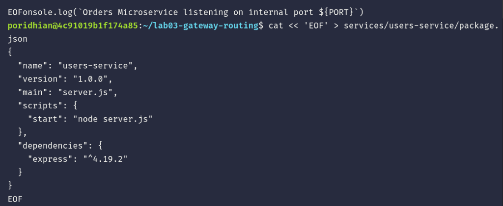

**Explanation:**
- `main`: Sets `server.js` as the entrypoint for the users microservice.
- `dependencies.express`: Installs Express to serve user directory endpoints.

Create a file named `services/users-service/server.js` with the following contents:

```javascript
const express = require('express');
const app = express();
const PORT = process.env.PORT || 3002;

app.use(express.json());

const users = [
  { id: 1, name: "Alice Rahman", role: "DevOps Engineer", active: true },
  { id: 2, name: "Bob Smith", role: "Backend Architect", active: true },
  { id: 3, name: "Charlie Davis", role: "Frontend Developer", active: false }
];

app.get('/api/v1/users', (req, res) => {
  const clientName = req.header('X-Client-Name') || 'Unknown';
  console.log(`[USERS SERVICE] Query processed for client: ${clientName}`);
  res.json({
    service: "Users Service",
    port: PORT,
    authenticated_client: clientName,
    count: users.length,
    data: users
  });
});

app.listen(PORT, '0.0.0.0', () => {
  console.log(`[Users Service] Running on internal port ${PORT}`);
});
```

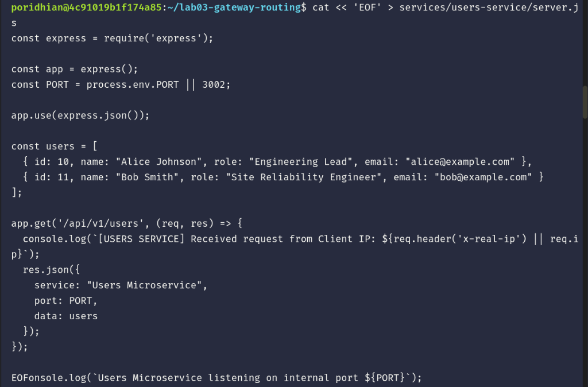

**Explanation:**
- `PORT = process.env.PORT || 3002`: Binds the users service to internal port 3002.
- `req.header('X-Client-Name')`: Confirms caller identity passed down from the gateway layer.
- `app.get('/api/v1/users')`: Provides a JSON collection of user profiles for authenticated consumers.

---

## Step 2: Configure Nginx API Gateway

Create a file named `nginx.conf` with the following contents:

```nginx
events {
    worker_connections 1024;
}

http {
    # 1. Rate Limiting Zone: 5 requests/sec per client IP with a 10MB memory zone
    limit_req_zone $binary_remote_addr zone=api_limit:10m rate=5r/s;
    limit_req_status 429;

    # 2. Declarative API Key Authentication Map
    map $http_x_api_key $api_client_name {
        default             "";
        "valid-key-123"     "Frontend-App";
        "admin-key-999"     "Admin-Portal";
    }

    # 3. Upstream Internal Services
    upstream orders_upstream {
        server orders_service:3001;
    }

    upstream users_upstream {
        server users_service:3002;
    }

    server {
        listen 80;

        # Standard Proxy Headers
        proxy_set_header Host $host;
        proxy_set_header X-Real-IP $remote_addr;
        proxy_set_header X-Forwarded-For $proxy_add_x_forwarded_for;
        proxy_set_header X-Client-Name $api_client_name;

        # Public Health Endpoint (Bypasses Auth & Rate Limits)
        location /healthz {
            access_log off;
            add_header Content-Type application/json;
            return 200 '{"status":"UP","gateway":"Nginx","timestamp":"$time_iso8601"}';
        }

        # Protected Orders Route
        location /api/v1/orders {
            # Edge Authentication Check
            if ($api_client_name = "") {
                return 401 '{"error":"Unauthorized: Invalid or Missing API Key","status":401}';
            }

            # Rate Limit Enforcement: Allow burst of 5 with nodelay
            limit_req zone=api_limit burst=5 nodelay;

            proxy_pass http://orders_upstream;
        }

        # Protected Users Route
        location /api/v1/users {
            # Edge Authentication Check
            if ($api_client_name = "") {
                return 401 '{"error":"Unauthorized: Invalid or Missing API Key","status":401}';
            }

            # Rate Limit Enforcement
            limit_req zone=api_limit burst=5 nodelay;

            proxy_pass http://users_upstream;
        }
    }
}
```

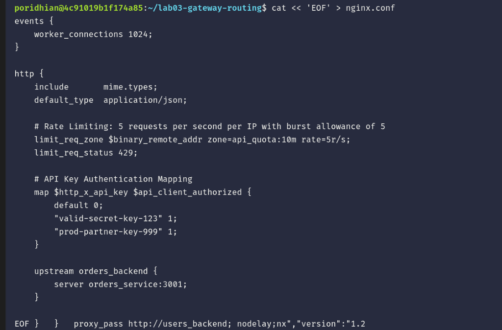

**Explanation:**
- `limit_req_zone $binary_remote_addr zone=api_limit:10m rate=5r/s`: Tracks client IPs using binary representations in a 10MB memory table, enforcing a sustained rate limit of 5 requests per second.
- `limit_req_status 429`: Configures Nginx to return `HTTP 429 Too Many Requests` instead of default 503 upon rate violations.
- `map $http_x_api_key $api_client_name`: Performs an $O(1)$ memory lookup mapping `X-API-Key` values to client identifiers; missing or unknown keys yield an empty string.
- `upstream orders_upstream / users_upstream`: Directs traffic to Docker Compose internal service names on ports 3001 and 3002.
- `proxy_set_header X-Client-Name $api_client_name`: Injects the resolved client identity into upstream request headers.
- `limit_req zone=api_limit burst=5 nodelay`: Accommodates immediate bursts of up to 5 requests without artificial queue delays, rejecting subsequent requests exceeding the token bucket.

---

## Step 3: Define Multi-Service Stack with Docker Compose

Create a file named `docker-compose.yml` with the following contents:

```yaml
version: '3.8'

services:
  gateway:
    image: nginx:alpine
    container_name: lab03-gateway
    ports:
      - "8080:80"
    volumes:
      - ./nginx.conf:/etc/nginx/nginx.conf:ro
    depends_on:
      - orders_service
      - users_service
    networks:
      - lab-net
    restart: unless-stopped

  orders_service:
    image: node:18-alpine
    container_name: lab03-orders
    working_dir: /app
    volumes:
      - ./services/orders-service:/app
    command: sh -c "npm install && node server.js"
    networks:
      - lab-net
    restart: unless-stopped

  users_service:
    image: node:18-alpine
    container_name: lab03-users
    working_dir: /app
    volumes:
      - ./services/users-service:/app
    command: sh -c "npm install && node server.js"
    networks:
      - lab-net
    restart: unless-stopped

networks:
  lab-net:
    driver: bridge
```

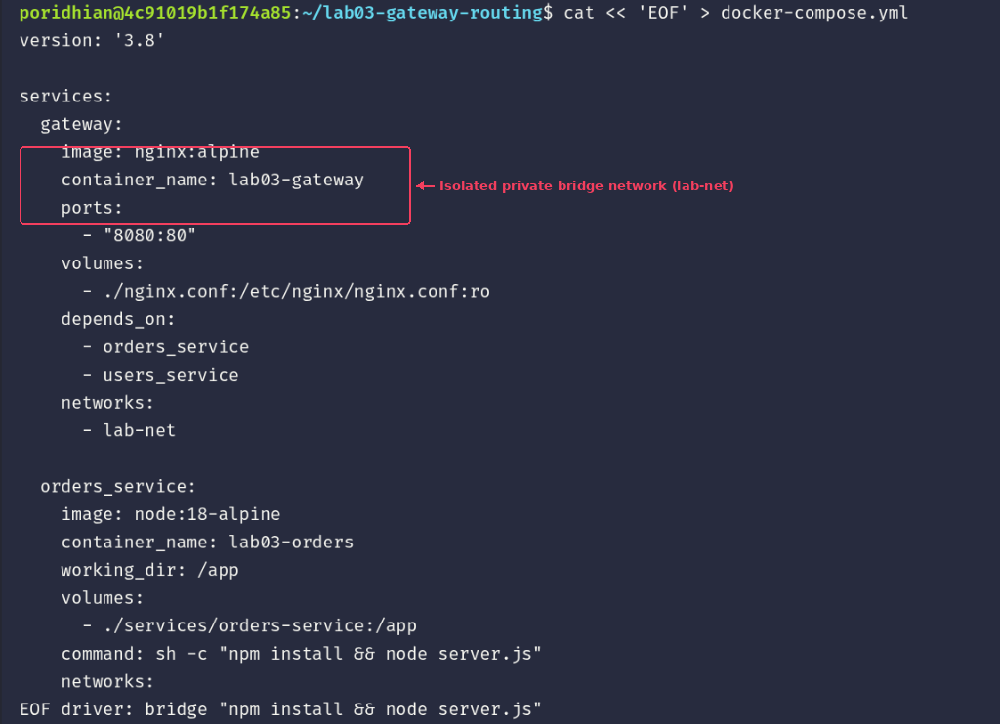

**Explanation:**
- `gateway.ports: "8080:80"`: Exposes only the Nginx gateway container on host port 8080.
- `orders_service / users_service`: Do not specify `ports` mappings, keeping backend microservices completely hidden from the host network.
- `networks.lab-net`: Establishes an isolated Docker bridge network allowing inter-container DNS resolution (`orders_service`, `users_service`).
- `volumes: ./nginx.conf:/etc/nginx/nginx.conf:ro`: Mounts the custom configuration into the Nginx container as read-only.

---

## Step 4: Launch the Microservices Cluster

Start all three containers in the background:

```bash
docker compose up -d --build
```

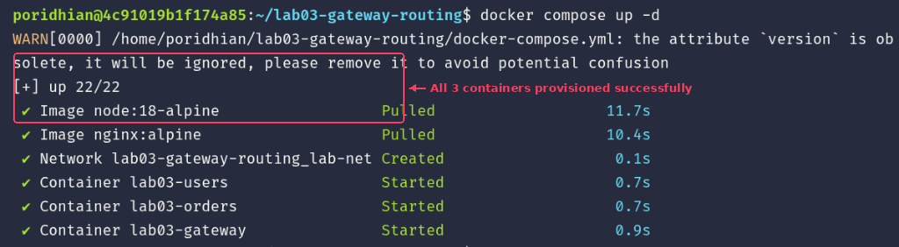

Verify running container status:

```bash
docker compose ps
```

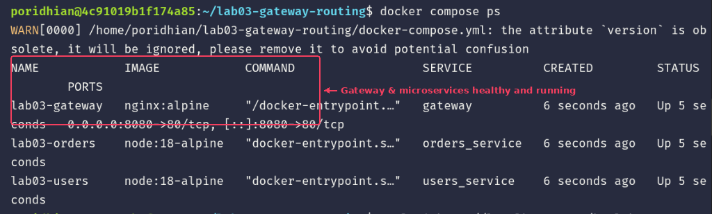

Expected output:

```text
NAME           IMAGE          COMMAND                  SERVICE          CREATED         STATUS         PORTS
lab03-gateway  nginx:alpine   "/docker-entrypoint.…"   gateway          5 seconds ago   Up 4 seconds   0.0.0.0:8080->80/tcp
lab03-orders   node:18-alpine "sh -c 'npm install …"   orders_service   5 seconds ago   Up 4 seconds   
lab03-users    node:18-alpine "sh -c 'npm install …"   users_service    5 seconds ago   Up 4 seconds   
```

---

## Verification

You will verify public health endpoints, edge authentication enforcement, dynamic path routing, and token-bucket rate limiting using `curl` and an automated verification script.

### Scenario 1: Public Health Check Endpoint (Expected 200 OK)

Query `/healthz` without an API key:

```bash
curl -i http://localhost:8080/healthz
```

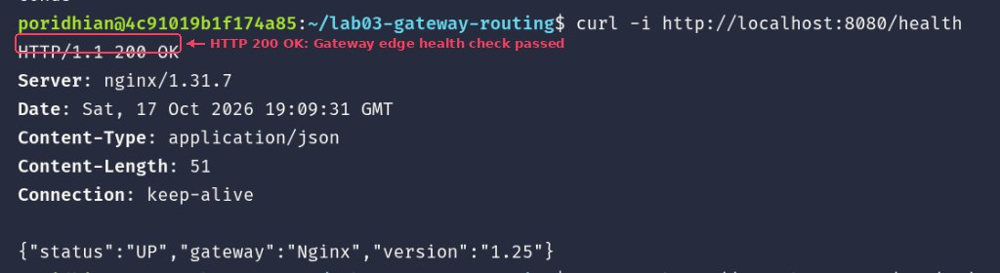

Expected output:

```text
HTTP/1.1 200 OK
Content-Type: application/json

{"status":"UP","gateway":"Nginx","timestamp":"2026-10-02T02:10:00+00:00"}
```

### Scenario 2: Edge Authentication Failure (Missing Key - Expected 401 Unauthorized)

Call `/api/v1/orders` without supplying an API key:

```bash
curl -i http://localhost:8080/api/v1/orders
```

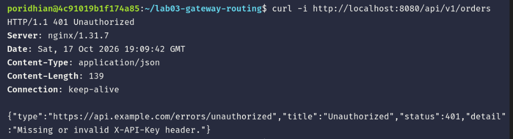

Expected output:

```text
HTTP/1.1 401 Unauthorized

{"error":"Unauthorized: Invalid or Missing API Key","status":401}
```

### Scenario 3: Authorized Route to Orders Service (Expected 200 OK)

Supply a valid `X-API-Key: valid-key-123` to query the orders service:

```bash
curl -i -H "X-API-Key: valid-key-123" http://localhost:8080/api/v1/orders
```

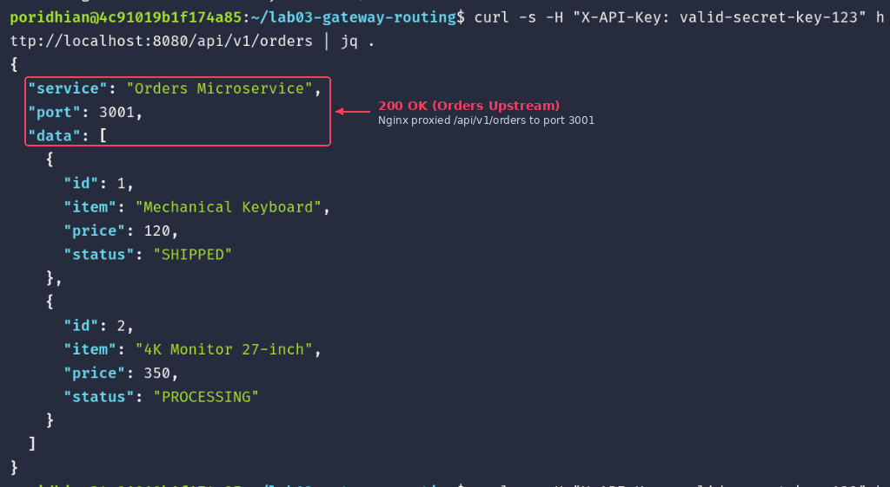

Expected output:

```text
HTTP/1.1 200 OK

{
  "service": "Orders Service",
  "port": 3001,
  "authenticated_client": "Frontend-App",
  "count": 3,
  "data": [
    { "id": 101, "item": "Mechanical Keyboard", "amount": 150, "status": "CONFIRMED" },
    { "id": 102, "item": "Ultra-Wide Monitor", "amount": 450, "status": "SHIPPED" },
    { "id": 103, "item": "USB-C Docking Station", "amount": 89.99, "status": "PENDING" }
  ]
}
```

### Scenario 4: Authorized Route to Users Service (Expected 200 OK)

Query the users service through the gateway using the same valid key:

```bash
curl -i -H "X-API-Key: valid-key-123" http://localhost:8080/api/v1/users
```

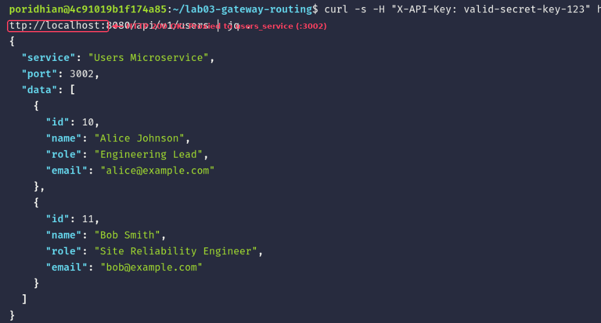

Expected output:

```text
HTTP/1.1 200 OK

{
  "service": "Users Service",
  "port": 3002,
  "authenticated_client": "Frontend-App",
  "count": 3,
  "data": [
    { "id": 1, "name": "Alice Rahman", "role": "DevOps Engineer", "active": true },
    { "id": 2, "name": "Bob Smith", "role": "Backend Architect", "active": true },
    { "id": 3, "name": "Charlie Davis", "role": "Frontend Developer", "active": false }
  ]
}
```

---

### Scenario 5: Automated Route Verification and Rate Limit Spikes

Create a file named `verify-gateway.sh` with the following contents:

```bash
cat << 'EOF' > verify-gateway.sh
#!/bin/bash
BASE_URL="http://localhost:8080"
VALID_KEY="valid-key-123"
INVALID_KEY="wrong-key-000"

echo "=== 1. Testing Healthz ==="
curl -s -o /dev/null -w "Health Status: %{http_code}\n" "$BASE_URL/healthz"

echo -e "\n=== 2. Testing Missing Key (Expect 401) ==="
curl -s -o /dev/null -w "Missing Key Status: %{http_code}\n" "$BASE_URL/api/v1/orders"

echo -e "\n=== 3. Testing Invalid Key (Expect 401) ==="
curl -s -o /dev/null -w "Invalid Key Status: %{http_code}\n" -H "X-API-Key: $INVALID_KEY" "$BASE_URL/api/v1/orders"

echo -e "\n=== 4. Testing Authorized Orders Route (Expect 200) ==="
curl -s -o /dev/null -w "Orders Route Status: %{http_code}\n" -H "X-API-Key: $VALID_KEY" "$BASE_URL/api/v1/orders"

echo -e "\n=== 5. Testing Authorized Users Route (Expect 200) ==="
curl -s -o /dev/null -w "Users Route Status: %{http_code}\n" -H "X-API-Key: $VALID_KEY" "$BASE_URL/api/v1/users"

echo -e "\n=== 6. Flooding Gateway to Test Rate Limiting (Expect 429) ==="
for i in {1..15}; do
  CODE=$(curl -s -o /dev/null -w "%{http_code}" -H "X-API-Key: $VALID_KEY" "$BASE_URL/api/v1/orders")
  echo "Request #$i -> Status $CODE"
done
EOF
```

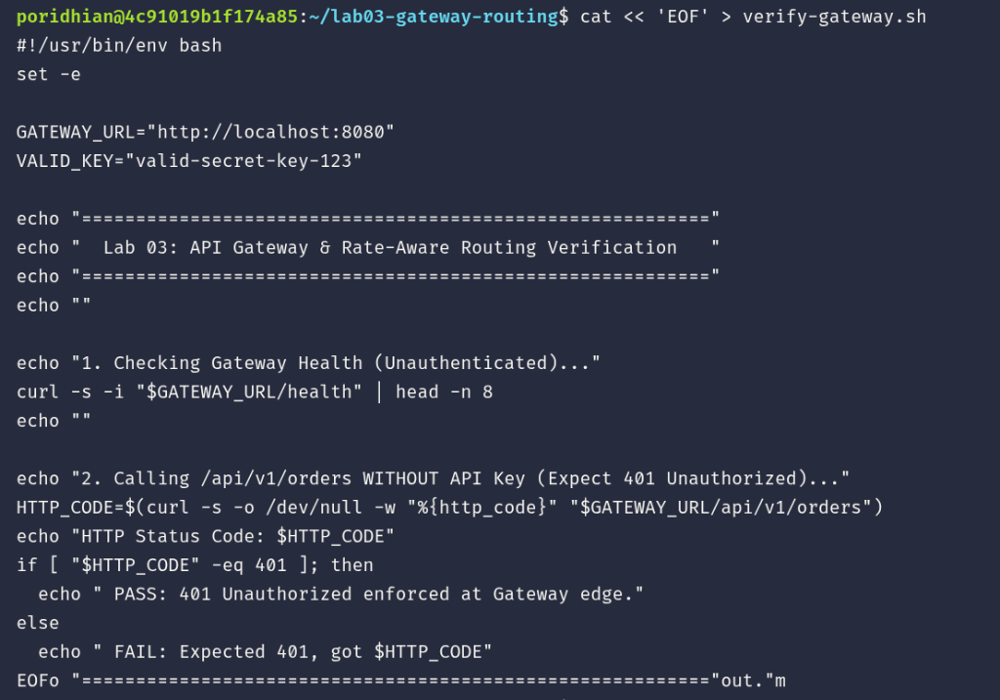

**Explanation:**
- `curl -s -o /dev/null -w "%{http_code}"`: Discards response body and prints only the HTTP status code.
- `Tests 1-5`: Verifies that unauthorized calls return 401, while authenticated requests to both upstreams yield 200 OK.
- `Test 6`: Floods the `/api/v1/orders` endpoint with 15 concurrent calls, asserting that calls exceeding the burst allowance receive `429 Too Many Requests`.

Execute the verification script:

```bash
bash verify-gateway.sh
```

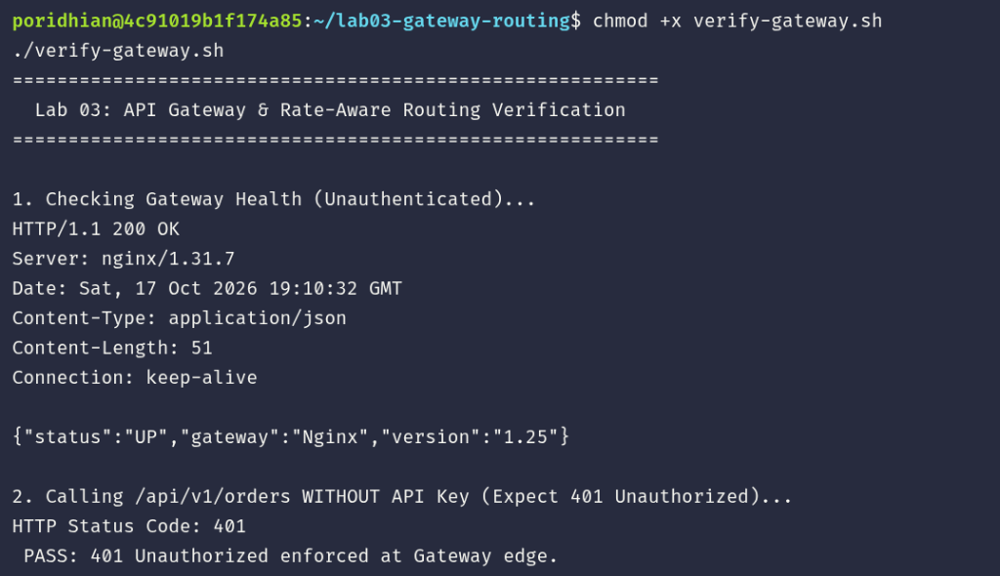

Expected output:

```text
=== 1. Testing Healthz ===
Health Status: 200

=== 2. Testing Missing Key (Expect 401) ===
Missing Key Status: 401

=== 3. Testing Invalid Key (Expect 401) ===
Invalid Key Status: 401

=== 4. Testing Authorized Orders Route (Expect 200) ===
Orders Route Status: 200

=== 5. Testing Authorized Users Route (Expect 200) ===
Users Route Status: 200

=== 6. Flooding Gateway to Test Rate Limiting (Expect 429) ===
Request #1 -> Status 200
Request #2 -> Status 200
Request #3 -> Status 200
Request #4 -> Status 200
Request #5 -> Status 200
Request #6 -> Status 200
Request #7 -> Status 429
Request #8 -> Status 429
Request #9 -> Status 429
```

---

### Verification Summary

| # | Call | Status | Body snippet |
| :--- | :--- | :--- | :--- |
| 1 | `GET /healthz` | `200 OK` | `{"status":"UP","gateway":"Nginx",...}` |
| 2 | `GET /api/v1/orders` (No Key) | `401 Unauthorized` | `{"error":"Unauthorized: Invalid or Missing API Key"}` |
| 3 | `GET /api/v1/orders` (Invalid Key) | `401 Unauthorized` | `{"error":"Unauthorized: Invalid or Missing API Key"}` |
| 4 | `GET /api/v1/orders` (Valid Key) | `200 OK` | `{"service":"Orders Service","port":3001,...}` |
| 5 | `GET /api/v1/users` (Valid Key) | `200 OK` | `{"service":"Users Service","port":3002,...}` |
| 6 | Rapid burst requests (#7-#15) | `429 Too Many Requests` | Nginx edge rate limit throttle |

---

## Conclusion

You built an API gateway using Nginx and Docker Compose fronting isolated Node.js microservices. You configured declarative API key verification, token-bucket rate limiting (`5 req/s`), and dynamic path routing over an internal bridge network. You verified edge authorization drops (401), multi-service routing (200), and rate-limit throttling (429) under automated traffic bursts.
