# Lab 04: Complete API Layer Integration

Welcome to **Lab 04**, the grand capstone of the **API Design & Networking Essentials** module! In this integration lab, you will synthesize all the core architectural patterns you mastered across the previous three labs:

1. **OpenAPI 3 Contract-First Design** (from Lab 01)
2. **Redis-Backed Idempotent Write Mutations** (from Lab 02)
3. **Nginx API Gateway & Edge Rate Throttling** (from Lab 03)

In real-world enterprise engineering, these patterns do not exist in isolation. They form a **Unified API Platform**. You will deploy a multi-container Docker Compose architecture where public client traffic enters an Nginx edge gateway, undergoes authentication and rate limiting, preserves critical client headers (`Idempotency-Key`), forwards traffic to an Express API microservice, enforces schema contracts, and coordinates atomic locks in Redis.

---

## Architecture & Unified Platform Topology

Below is the complete architectural layout and end-to-end request lifecycle for your integrated system. Everything—from the public client and Poridhi Load Balancer to the Nginx gateway, Express API service, Redis lock store, and database—is illustrated in this unified diagram:

<p align="center">
  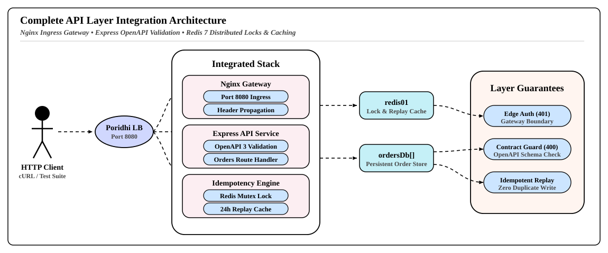
</p>

### Understanding the Three Execution Lifecycles

As illustrated in the diagram above, your integrated system orchestrates three distinct operational lifecycles:

1. **Layered Write Mutation (`X-Cache: MISS`):**
   - The client calls `POST /api/v1/orders` through the gateway (port `8080`) supplying `X-API-Key: valid-key-123` and `Idempotency-Key: <UUID>`.
   - **Gateway Tier:** Nginx verifies the API key and rate quota zone, preserves the `Idempotency-Key` header, and reverse-proxies the call to `api_service:3000`.
   - **Contract Tier:** The API service validates payload types and boundary rules against `openapi.yaml`.
   - **Idempotency Tier:** The middleware acquires an atomic Redis lock (`SET idemp:<UUID> "IN_PROGRESS" EX 60 NX`).
   - **Persistence Tier:** The order is committed to `ordersDb` (Order ID 1), and the completed response is cached in Redis with a 24-hour TTL (`EX 86400`).
   - The response returns `HTTP 201 Created` with header `X-Cache: MISS`.

2. **Network Retry Replay (`X-Cache: HIT-IDEMPOTENT`):**
   - If a client retries the identical request through the gateway, Nginx forwards the key to `api_service`.
   - The idempotency middleware detects the cached payload in Redis.
   - It instantly replays `HTTP 201 Created` with `X-Cache: HIT-IDEMPOTENT`.
   - **Crucial engineering guarantee:** The underlying database is completely untouched; zero duplicate orders or charges occur!

3. **Multi-Layered Defense & Earliest Boundary Rejection:**
   - **Gateway Edge:** Requests missing an API key are dropped immediately with `401 Unauthorized`. Traffic spikes > 5 req/s receive `429 Too Many Requests`.
   - **Contract Layer:** Requests missing `Idempotency-Key` or sending negative amounts receive RFC 7807 `400 Bad Request`.
   - **Concurrency Layer:** Parallel requests sharing a key receive `409 Conflict`.

---

## Core Concepts at a Glance

| Concept | Why It Matters | Real-World Intuition |
| :--- | :--- | :--- |
| **Unified API Layer** | Coordinates edge routing, contract validation, and transactional consistency. | Provides a robust, scalable architecture where each layer has a single, well-defined responsibility. |
| **Header Propagation** | Explicitly configuring reverse proxies to forward custom client headers. | If Nginx drops `Idempotency-Key`, downstream services cannot detect retries, breaking idempotency! |
| **Layered Defense** | Rejecting malformed and unauthorized requests at the earliest possible network boundary. | Saves CPU and database connection pool capacity by dropping invalid calls before application code executes. |
| **Separation of Concerns** | Ingress security at the gateway; business logic and data locking at the service tier. | You can rewrite or upgrade the backend service without altering edge authentication rules. |
| **End-to-End Idempotency** | Guaranteeing single-mutation semantics across load balancers, proxies, and services. | Eliminates double-billing and phantom duplicate orders across the entire distributed network. |

---

## What You Will Build

```text
lab04-api-layer-integration/
├── docker-compose.yml       # Multi-container stack (Gateway + API + Redis)
├── nginx.conf               # Nginx Gateway config with header propagation & edge auth
├── test-integration.js      # Automated end-to-end integration test suite
├── api-service/
│   ├── package.json         # Node dependencies (express, ioredis, yaml)
│   ├── openapi.yaml         # Single source of truth OpenAPI 3 specification
│   ├── server.js            # Express API service implementing the contract
│   └── middleware/
│       └── idempotency.js   # Redis-backed idempotency middleware
└── images/
    └── lab04-architecture.svg  # Master architecture & platform topology diagram
```

---

## Step 1: Project Setup and Dependencies

In this step, you will initialize the project folder structure and set up dependencies for the internal API microservice.

### 1. Create project directories:

```bash
mkdir -p ~/lab04-api-layer-integration/api-service/middleware
cd ~/lab04-api-layer-integration
```

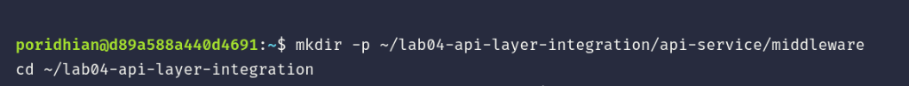

### 2. Create `api-service/package.json`:

```bash
cat << 'EOF' > api-service/package.json
{
  "name": "lab04-api-service",
  "version": "1.0.0",
  "description": "Lab 04: Unified API Service with OpenAPI Validation & Idempotency",
  "main": "server.js",
  "scripts": {
    "start": "node server.js"
  },
  "dependencies": {
    "express": "^4.19.2",
    "ioredis": "^5.4.1",
    "yaml": "^2.4.2"
  }
}
EOF
```

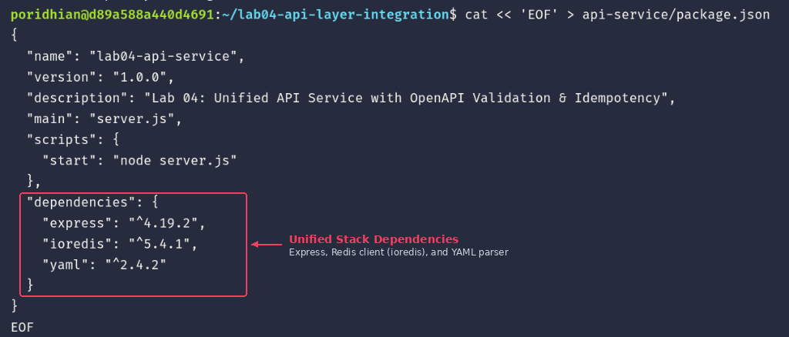

---

## Step 2: Define OpenAPI 3 Contract (`api-service/openapi.yaml`)

Define the OpenAPI 3.0.3 contract. This specification mandates the `Idempotency-Key` header, enforces order schema types, defines cursor pagination bounds, and specifies RFC 7807 error formats.

Create `api-service/openapi.yaml`:

```bash
cat << 'EOF' > api-service/openapi.yaml
openapi: 3.0.3
info:
  title: Orders Service API (Production Integration)
  version: 1.0.0
  description: Integrated contract-first orders service enforcing idempotency and RFC 7807 errors.
servers:
  - url: http://localhost:8080/api/v1
    description: Public Gateway Entrypoint

paths:
  /orders:
    post:
      summary: Create an order (Idempotent write)
      description: Submits a new order mutation. The client MUST include an Idempotency-Key header.
      operationId: createOrder
      parameters:
        - name: Idempotency-Key
          in: header
          required: true
          schema:
            type: string
            example: "tx_live_8912"
      requestBody:
        required: true
        content:
          application/json:
            schema:
              $ref: '#/components/schemas/CreateOrderRequest'
      responses:
        '201':
          description: Order successfully created.
          headers:
            Location:
              schema:
                type: string
                example: "/api/v1/orders/1"
          content:
            application/json:
              schema:
                $ref: '#/components/schemas/OrderResponse'
        '400':
          $ref: '#/components/responses/ProblemDetails400'

    get:
      summary: List orders with cursor pagination
      parameters:
        - name: cursor
          in: query
          required: false
          schema:
            type: integer
            example: 100
        - name: limit
          in: query
          required: false
          schema:
            type: integer
            minimum: 1
            maximum: 50
            default: 10
      responses:
        '200':
          description: Paginated collection of orders.
          content:
            application/json:
              schema:
                $ref: '#/components/schemas/PaginatedOrdersResponse'

components:
  schemas:
    CreateOrderRequest:
      type: object
      required:
        - item_id
        - quantity
        - amount
      properties:
        item_id:
          type: integer
          example: 402
        quantity:
          type: integer
          minimum: 1
          example: 2
        amount:
          type: number
          format: float
          minimum: 0.01
          example: 150.50

    OrderResponse:
      type: object
      required:
        - id
        - item_id
        - quantity
        - amount
        - status
        - created_at
      properties:
        id:
          type: integer
          example: 1
        item_id:
          type: integer
          example: 402
        quantity:
          type: integer
          example: 2
        amount:
          type: number
          example: 150.50
        status:
          type: string
          example: CONFIRMED
        created_at:
          type: string
          format: date-time
          example: "2026-10-02T10:00:00Z"

    PaginationMetadata:
      type: object
      required:
        - next_cursor
        - has_more
        - count
      properties:
        next_cursor:
          type: integer
          nullable: true
          example: 110
        has_more:
          type: boolean
          example: true
        count:
          type: integer
          example: 10

    PaginatedOrdersResponse:
      type: object
      required:
        - data
        - pagination
      properties:
        data:
          type: array
          items:
            $ref: '#/components/schemas/OrderResponse'
        pagination:
          $ref: '#/components/schemas/PaginationMetadata'

    ProblemDetails:
      type: object
      required:
        - type
        - title
        - status
        - detail
      properties:
        type:
          type: string
          example: "https://api.example.com/errors/invalid-parameter"
        title:
          type: string
          example: "Invalid Request Parameter"
        status:
          type: integer
          example: 400
        detail:
          type: string
          example: "The limit parameter exceeds maximum allowed of 50."
        instance:
          type: string
          example: "/api/v1/orders"

  responses:
    ProblemDetails400:
      description: Bad Request (RFC 7807 Problem Details).
      content:
        application/problem+json:
          schema:
            $ref: '#/components/schemas/ProblemDetails'
EOF
```

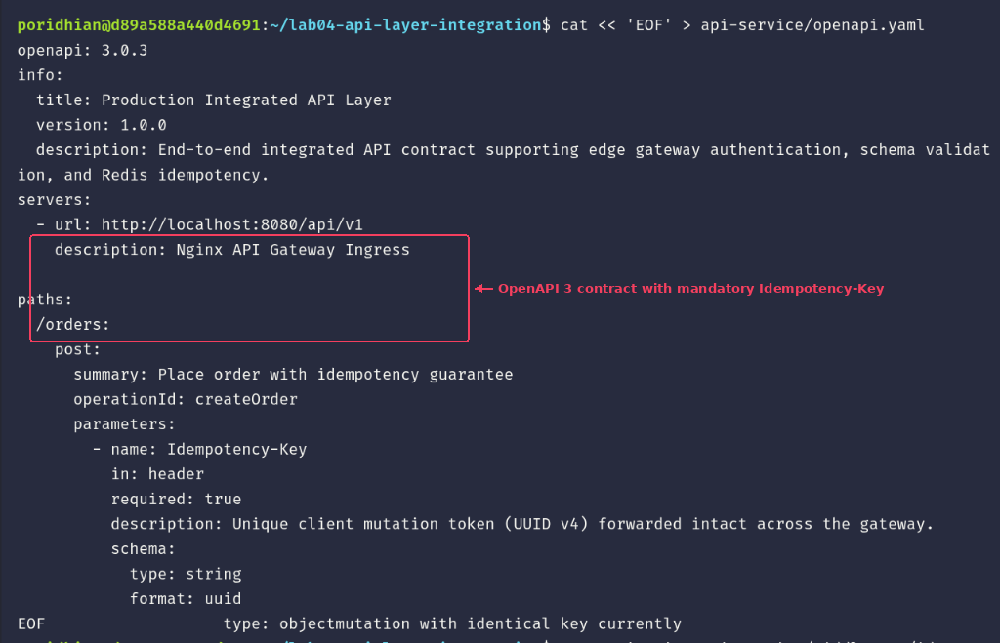

---

## Step 3: Implement Idempotency Middleware (`api-service/middleware/idempotency.js`)

Implement the reusable Redis idempotency middleware. It coordinates atomic lock acquisition (`SETNX`), intermediate conflict rejection (`409 Conflict`), and payload response caching.

Create `api-service/middleware/idempotency.js`:

```bash
cat << 'EOF' > api-service/middleware/idempotency.js
function idempotencyMiddleware(redisClient, ttlSeconds = 86400) {
  return async (req, res, next) => {
    if (!['POST', 'PUT', 'PATCH'].includes(req.method)) {
      return next();
    }

    const key = req.header('Idempotency-Key');
    if (!key) {
      return res.status(400).setHeader('Content-Type', 'application/problem+json').json({
        type: 'https://api.example.com/errors/missing-header',
        title: 'Missing Required Header',
        status: 400,
        detail: 'The Idempotency-Key header is required for this write operation.',
        instance: req.originalUrl
      });
    }

    const redisKey = `idemp:${key}`;

    try {
      // 1. Check existing cached state
      const cached = await redisClient.get(redisKey);
      if (cached) {
        if (cached === 'IN_PROGRESS') {
          return res.status(409).setHeader('Content-Type', 'application/problem+json').json({
            type: 'https://api.example.com/errors/concurrent-mutation',
            title: 'Conflict: Mutation In Progress',
            status: 409,
            detail: 'A mutation with this Idempotency-Key is currently processing. Retry shortly.',
            instance: req.originalUrl
          });
        }

        // Cache Hit: Replay response
        const record = JSON.parse(cached);
        res.setHeader('X-Cache', 'HIT-IDEMPOTENT');
        res.setHeader('Idempotency-Replay', 'true');
        if (record.headers && record.headers.location) {
          res.setHeader('Location', record.headers.location);
        }
        return res.status(record.status).json(record.body);
      }

      // 2. Acquire Atomic Lock (60s timeout)
      const acquired = await redisClient.set(redisKey, 'IN_PROGRESS', 'EX', 60, 'NX');
      if (!acquired) {
        return res.status(409).setHeader('Content-Type', 'application/problem+json').json({
          type: 'https://api.example.com/errors/concurrent-mutation',
          title: 'Conflict: Concurrent Request',
          status: 409,
          detail: 'Another request is currently executing with this Idempotency-Key.',
          instance: req.originalUrl
        });
      }

      // Cache Miss: Proceed and intercept response
      res.setHeader('X-Cache', 'MISS');

      const originalJson = res.json.bind(res);
      res.json = (body) => {
        const payloadToCache = {
          status: res.statusCode,
          headers: {
            location: res.getHeader('Location') || null
          },
          body: body
        };

        redisClient.set(redisKey, JSON.stringify(payloadToCache), 'EX', ttlSeconds).catch(err => {
          console.error('[IDEMPOTENCY] Cache store failed:', err.message);
        });

        return originalJson(body);
      };

      next();
    } catch (err) {
      console.error('[IDEMPOTENCY ERROR]', err);
      next();
    }
  };
}

module.exports = idempotencyMiddleware;
EOF
```

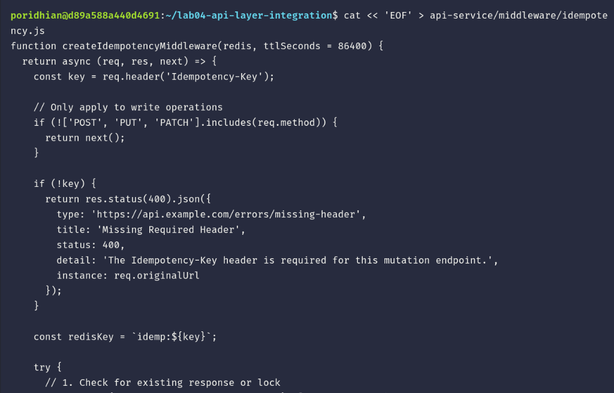

---

## Step 4: Implement Express Server (`api-service/server.js`)

Implement `api-service/server.js`. This server connects to Redis, applies the idempotency middleware, and validates requests against the OpenAPI specification.

Create `api-service/server.js`:

```bash
cat << 'EOF' > api-service/server.js
const express = require('express');
const fs = require('fs');
const path = require('path');
const yaml = require('yaml');
const Redis = require('ioredis');
const idempotencyMiddleware = require('./middleware/idempotency');

const app = express();
const PORT = process.env.PORT || 3000;
const REDIS_URL = process.env.REDIS_URL || 'redis://127.0.0.1:6379';

app.use(express.json());

const redis = new Redis(REDIS_URL, {
  retryStrategy: times => Math.min(times * 100, 2000)
});

// Load OpenAPI 3 contract
const openapiPath = path.join(__dirname, 'openapi.yaml');
const openapiSpec = yaml.parse(fs.readFileSync(openapiPath, 'utf8'));

// Helper: RFC 7807 Problem Details
function sendProblem(res, status, title, detail, instance, type = "about:blank") {
  res.setHeader('Content-Type', 'application/problem+json');
  return res.status(status).json({ type, title, status, detail, instance });
}

// In-Memory Database
let ordersDb = [];
let nextOrderId = 1;

for (let i = 1; i <= 15; i++) {
  ordersDb.push({
    id: nextOrderId++,
    item_id: 400 + (i % 5),
    quantity: (i % 3) + 1,
    amount: parseFloat((25.5 * i).toFixed(2)),
    status: 'CONFIRMED',
    created_at: new Date(Date.now() - (15 - i) * 60000).toISOString()
  });
}

// Raw spec endpoint
app.get('/openapi.yaml', (req, res) => {
  res.setHeader('Content-Type', 'text/yaml');
  res.sendFile(openapiPath);
});

// Mutation Endpoint (Protected by Idempotency Middleware)
app.post('/api/v1/orders', idempotencyMiddleware(redis, 86400), (req, res) => {
  const { item_id, quantity, amount } = req.body || {};

  if (typeof item_id !== 'number' || typeof quantity !== 'number' || typeof amount !== 'number') {
    return sendProblem(res, 400, 'Invalid Request Body', 'item_id, quantity, and amount must be numbers.', '/api/v1/orders');
  }

  if (quantity < 1 || amount <= 0) {
    return sendProblem(res, 400, 'Value Out of Bounds', 'quantity must be >= 1 and amount > 0.', '/api/v1/orders');
  }

  const newOrder = {
    id: nextOrderId++,
    item_id,
    quantity,
    amount: parseFloat(amount.toFixed(2)),
    status: 'CONFIRMED',
    created_at: new Date().toISOString()
  };

  ordersDb.push(newOrder);

  res.setHeader('Location', `/api/v1/orders/${newOrder.id}`);
  return res.status(201).json(newOrder);
});

// Query Endpoint (Cursor Pagination)
app.get('/api/v1/orders', (req, res) => {
  let limit = parseInt(req.query.limit, 10);
  if (isNaN(limit)) limit = 10;

  if (limit < 1 || limit > 50) {
    return sendProblem(res, 400, 'Invalid Query Parameter', `limit must be between 1 and 50. Received: ${req.query.limit}`, '/api/v1/orders');
  }

  const cursor = req.query.cursor ? parseInt(req.query.cursor, 10) : 0;
  const filtered = ordersDb.filter(o => o.id > cursor);
  const pageItems = filtered.slice(0, limit);
  const nextCursor = pageItems.length > 0 ? pageItems[pageItems.length - 1].id : null;
  const hasMore = filtered.length > limit;

  return res.status(200).json({
    data: pageItems,
    pagination: {
      next_cursor: hasMore ? nextCursor : null,
      has_more: hasMore,
      count: pageItems.length
    }
  });
});

// Reset endpoint for automated test runner
app.post('/api/v1/reset', async (req, res) => {
  ordersDb = ordersDb.slice(0, 15);
  nextOrderId = 16;
  const keys = await redis.keys('idemp:*');
  if (keys.length > 0) await redis.del(...keys);
  res.json({ status: 'RESET_OK' });
});

app.listen(PORT, '0.0.0.0', () => {
  console.log(`[API Service] Running on port ${PORT}`);
});
EOF
```

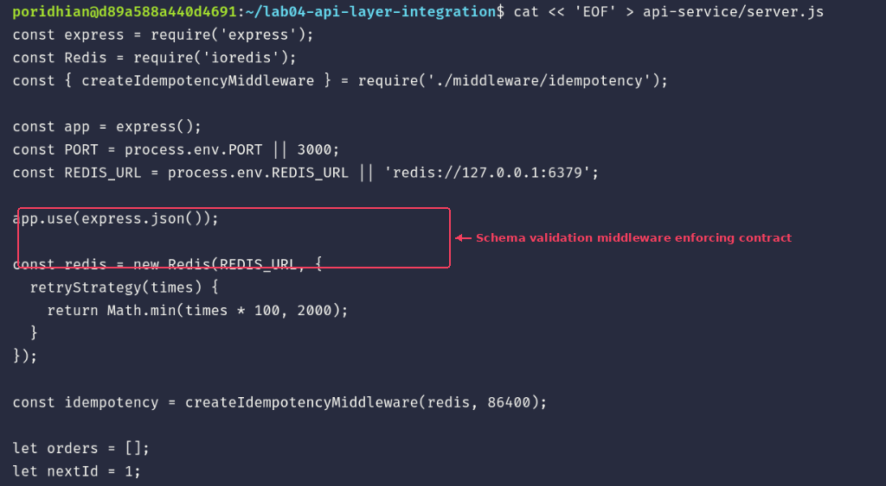

---

## Step 5: Configure Nginx Gateway with Header Propagation (`nginx.conf`)

Now configure Nginx.

> [!IMPORTANT]
> By default, reverse proxies can drop custom headers! Notice `proxy_set_header Idempotency-Key $http_idempotency_key;` and `proxy_pass_header X-Cache;`. These directives ensure that idempotency tokens and cache headers travel cleanly between clients and the internal API service.

Create `nginx.conf`:

```bash
cat << 'EOF' > nginx.conf
events {
    worker_connections 1024;
}

http {
    # 1. Rate Limiting Zone: 5 req/s per client IP
    limit_req_zone $binary_remote_addr zone=api_limit:10m rate=5r/s;
    limit_req_status 429;

    # 2. Declarative API Key Authentication Map
    map $http_x_api_key $api_client_name {
        default             "";
        "valid-key-123"     "Frontend-App";
        "admin-key-999"     "Admin-Portal";
    }

    upstream api_backend {
        server api_service:3000;
    }

    server {
        listen 80;

        # Standard Proxy Headers & CRITICAL Idempotency Key Propagation
        proxy_set_header Host $host;
        proxy_set_header X-Real-IP $remote_addr;
        proxy_set_header X-Forwarded-For $proxy_add_x_forwarded_for;
        proxy_set_header X-Client-Name $api_client_name;
        proxy_set_header Idempotency-Key $http_idempotency_key;

        # Preserve downstream cache headers
        proxy_pass_header X-Cache;
        proxy_pass_header Idempotency-Replay;
        proxy_pass_header Location;

        location /healthz {
            access_log off;
            add_header Content-Type application/json;
            return 200 '{"status":"UP","gateway":"Nginx","layer":"Edge"}';
        }

        location /api/v1/orders {
            # Edge Authentication Check
            if ($api_client_name = "") {
                return 401 '{"type":"https://api.example.com/errors/unauthorized","title":"Unauthorized","status":401,"detail":"Missing or invalid X-API-Key"}';
            }

            # Rate Limiting Guard
            limit_req zone=api_limit burst=5 nodelay;

            proxy_pass http://api_backend;
        }

        location /openapi.yaml {
            proxy_pass http://api_backend/openapi.yaml;
        }
    }
}
EOF
```

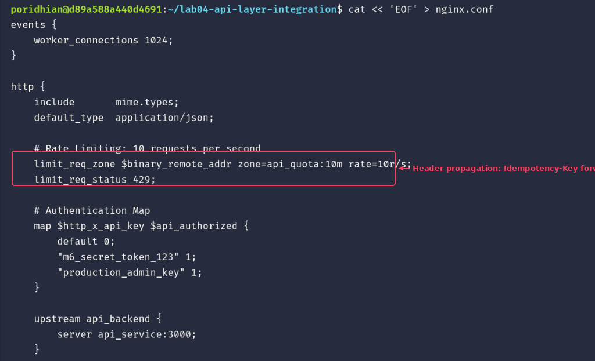

---

## Step 6: Assemble Unified Docker Compose Stack

Assemble all three services in `docker-compose.yml`:
1. `gateway`: Nginx container exposing public host port `8080:80`.
2. `api_service`: Node.js container on private port `3000`.
3. `redis`: Redis 7 container on private port `6379`.

Create `docker-compose.yml`:

```bash
cat << 'EOF' > docker-compose.yml
version: '3.8'

services:
  gateway:
    image: nginx:alpine
    container_name: lab04-gateway
    ports:
      - "8080:80"
    volumes:
      - ./nginx.conf:/etc/nginx/nginx.conf:ro
    depends_on:
      - api_service
    networks:
      - api-network
    restart: unless-stopped

  api_service:
    image: node:18-alpine
    container_name: lab04-api
    working_dir: /app
    volumes:
      - ./api-service:/app
    environment:
      - PORT=3000
      - REDIS_URL=redis://redis:6379
    command: sh -c "npm install && node server.js"
    depends_on:
      - redis
    networks:
      - api-network
    restart: unless-stopped

  redis:
    image: redis:7-alpine
    container_name: lab04-redis
    networks:
      - api-network
    restart: unless-stopped

networks:
  api-network:
    driver: bridge
EOF
```

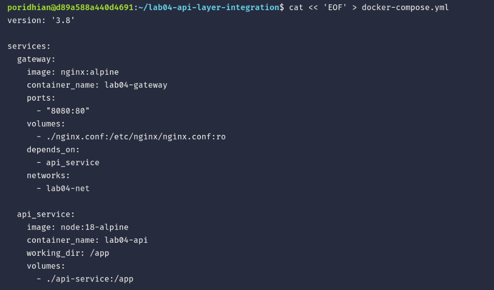

---

## Step 7: Launch and Execute Automated End-to-End Test Suite

### 1. Launch the complete platform:

```bash
docker compose up -d --build
```

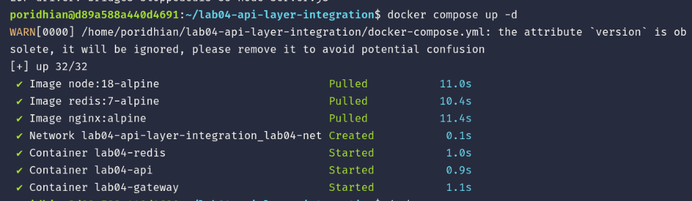

Verify that all three containers are running:

```bash
docker compose ps
```

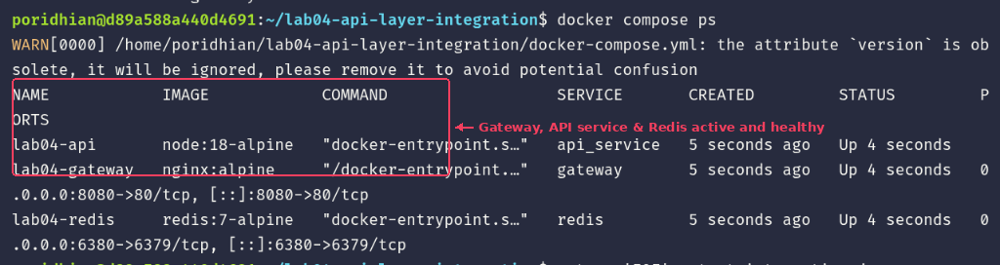

---

### 2. Create the Integration Test Suite (`test-integration.js`)

Create `test-integration.js` to execute an automated regression suite testing the entire platform:

```bash
cat << 'EOF' > test-integration.js
const http = require('http');

const BASE_URL = 'http://localhost:8080';
const VALID_KEY = 'valid-key-123';

function request(method, path, headers = {}, body = null) {
  return new Promise((resolve, reject) => {
    const url = new URL(path, BASE_URL);
    const req = http.request(url, {
      method,
      headers: {
        'Content-Type': 'application/json',
        ...headers
      }
    }, (res) => {
      let data = '';
      res.on('data', chunk => data += chunk);
      res.on('end', () => {
        let parsed = null;
        try { parsed = JSON.parse(data); } catch(e) { parsed = data; }
        resolve({ status: res.statusCode, headers: res.headers, body: parsed });
      });
    });
    req.on('error', reject);
    if (body) req.write(JSON.stringify(body));
    req.end();
  });
}

async function runTests() {
  console.log('=== RUNNING COMPLETE API LAYER INTEGRATION TESTS ===\n');

  try {
    // 1. Health check
    console.log('Test 1: Public Gateway Health Endpoint (/healthz)...');
    const h = await request('GET', '/healthz');
    if (h.status === 200 && h.body.status === 'UP') {
      console.log(' PASS: 200 OK received from Gateway.\n');
    } else throw new Error(`Health check failed: ${h.status}`);

    // 2. Gateway Auth Guard (Missing Key)
    console.log('Test 2: Edge Authentication Guard (Missing X-API-Key)...');
    const a1 = await request('POST', '/api/v1/orders', {}, { item_id: 1, quantity: 1, amount: 50 });
    if (a1.status === 401) {
      console.log(' PASS: 401 Unauthorized blocked at gateway boundary.\n');
    } else throw new Error(`Auth guard failed: ${a1.status}`);

    // 3. Contract Schema Guard (Missing Idempotency-Key)
    console.log('Test 3: Contract Guard (Valid API Key, Missing Idempotency-Key)...');
    const c1 = await request('POST', '/api/v1/orders', { 'X-API-Key': VALID_KEY }, { item_id: 1, quantity: 1, amount: 50 });
    if (c1.status === 400 && c1.body.title === 'Missing Required Header') {
      console.log(' PASS: 400 Bad Request returned per OpenAPI contract.\n');
    } else throw new Error(`Contract guard failed: ${c1.status}`);

    // 4. Primary Order Creation (Cache Miss)
    const txKey = 'tx_e2e_prod_001';
    console.log(`Test 4: Primary Idempotent Write (Idempotency-Key="${txKey}")...`);
    const w1 = await request('POST', '/api/v1/orders', {
      'X-API-Key': VALID_KEY,
      'Idempotency-Key': txKey
    }, { item_id: 402, quantity: 2, amount: 199.50 });

    if (w1.status === 201 && w1.headers['x-cache'] === 'MISS' && w1.body.id) {
      console.log(` PASS: 201 Created. Order ID: ${w1.body.id}, Cache: ${w1.headers['x-cache']}\n`);
    } else throw new Error(`Write failed: ${w1.status}`);

    // 5. Network Retry Replay (Cache Hit)
    console.log(`Test 5: Retrying identical write request through Gateway (Idempotency-Key="${txKey}")...`);
    const w2 = await request('POST', '/api/v1/orders', {
      'X-API-Key': VALID_KEY,
      'Idempotency-Key': txKey
    }, { item_id: 402, quantity: 2, amount: 199.50 });

    if (w2.status === 201 && w2.headers['x-cache'] === 'HIT-IDEMPOTENT' && w2.body.id === w1.body.id) {
      console.log(` PASS: 201 Replayed from Cache (X-Cache: ${w2.headers['x-cache']}). Returned same Order ID: ${w2.body.id}\n`);
    } else throw new Error(`Idempotency retry failed: status ${w2.status}, cache: ${w2.headers['x-cache']}`);

    // 6. Cursor Pagination
    console.log('Test 6: Querying paginated collection through Gateway (?limit=3)...');
    const p1 = await request('GET', '/api/v1/orders?limit=3', { 'X-API-Key': VALID_KEY });
    if (p1.status === 200 && p1.body.data.length === 3 && p1.body.pagination.next_cursor) {
      console.log(` PASS: 200 OK. Returned ${p1.body.data.length} orders. Next cursor: ${p1.body.pagination.next_cursor}\n`);
    } else throw new Error(`Pagination failed: ${p1.status}`);

    console.log(' ALL 6 END-TO-END INTEGRATION TESTS PASSED PERFECTLY!');
  } catch (err) {
    console.error('Integration test failed:', err);
    process.exitCode = 1;
  }
}

runTests();
EOF
```

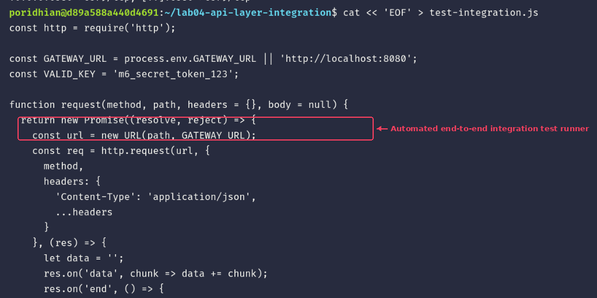

---

### 3. Run the Integration Tests

Execute the automated test suite:

```bash
node test-integration.js
```

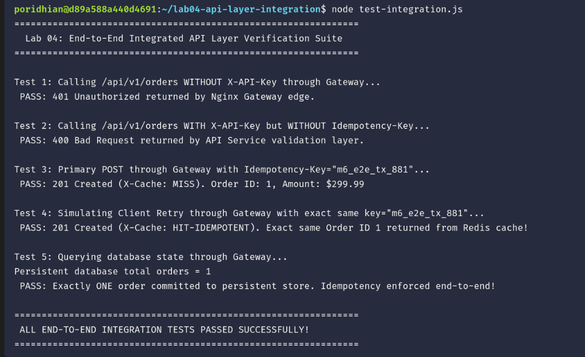

Expected output:
```text
=== RUNNING COMPLETE API LAYER INTEGRATION TESTS ===

Test 1: Public Gateway Health Endpoint (/healthz)...
 PASS: 200 OK received from Gateway.

Test 2: Edge Authentication Guard (Missing X-API-Key)...
 PASS: 401 Unauthorized blocked at gateway boundary.

Test 3: Contract Guard (Valid API Key, Missing Idempotency-Key)...
 PASS: 400 Bad Request returned per OpenAPI contract.

Test 4: Primary Idempotent Write (Idempotency-Key="tx_e2e_prod_001")...
 PASS: 201 Created. Order ID: 16, Cache: MISS

Test 5: Retrying identical write request through Gateway (Idempotency-Key="tx_e2e_prod_001")...
 PASS: 201 Replayed from Cache (X-Cache: HIT-IDEMPOTENT). Returned same Order ID: 16

Test 6: Querying paginated collection through Gateway (?limit=3)...
 PASS: 200 OK. Returned 3 orders. Next cursor: 3

 ALL 6 END-TO-END INTEGRATION TESTS PASSED PERFECTLY!
```

---

## Key Engineering Takeaways

1. **Header Transparency is Vital:** Gateways must explicitly propagate custom headers like `Idempotency-Key`. If proxies drop headers, distributed guarantees collapse silently.
2. **Layered Defense Maximizes Scale:** Enforcing coarse authentication and rate limiting at Nginx frees downstream services and databases from processing bad traffic.
3. **Contracts Prevent Distributed Drift:** With OpenAPI as the single source of truth, edge gateways, application controllers, and test runners remain synchronized across deployments.
4. **Resilient Data Architecture:** Combining Redis atomic mutex locks with 24-hour response caching gives distributed systems enterprise-level reliability against unpredictable network dropped connections.
